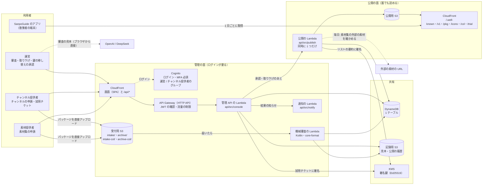
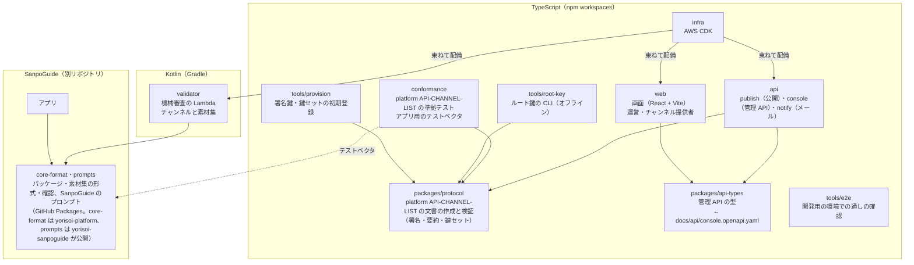
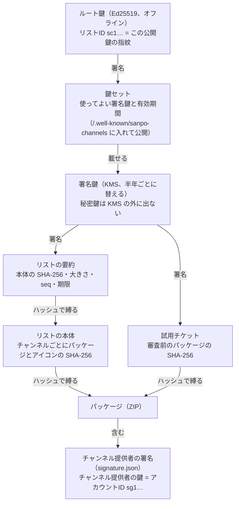
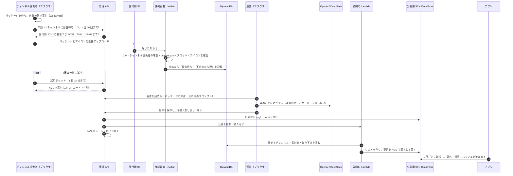
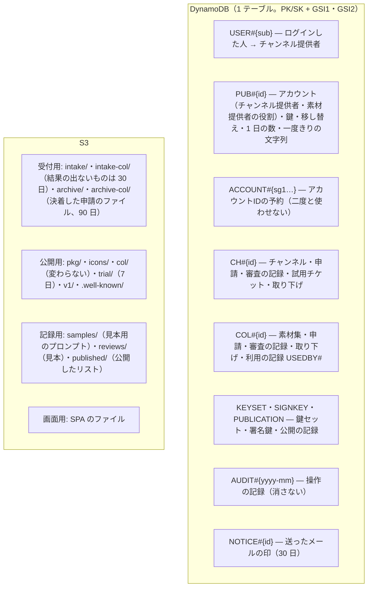
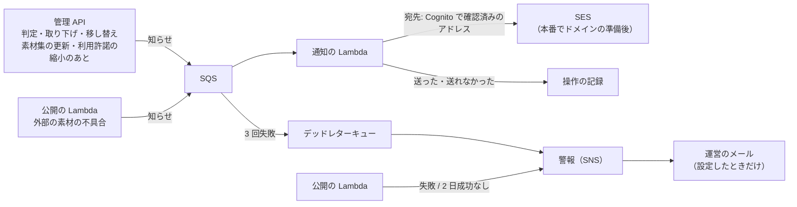

# チャンネル管理システムの構成図

yorisoi-console を 8 枚の図で説明する。図 1 で「誰が何を使い、どこに何があるか」をつかみ、図 2〜3 でリポジトリと信頼の仕組み、図 4〜8 で申請から公開まで・公開の処理・データの置き場所・メールと警報・環境を追う。

- 何をするシステムか: SanpoGuide のアプリに第三者のチャンネルと素材集を届けるため、チャンネル提供者・素材提供者の申請を審査し、承認したものだけを署名したリスト（承認済みチャンネル・リスト）で公開する
- アプリとの境界は [platform API-CHANNEL-LIST](https://github.com/duwenji/yorisoi-platform/blob/main/docs/contracts/API-CHANNEL-LIST.md) だけ。アプリはこのシステムの API を呼ばず、公開された静的ファイルを取りに来る
- 規模: ソース 71 ファイル・約 10,440 行（TypeScript と Kotlin。テスト・生成した型・e2e を除く）、テスト 16 ファイル・約 2,920 行。Lambda 5 つ、画面 1 つ（運営・チャンネル提供者・素材提供者で共用）、管理 API 66 操作、DynamoDB のテーブル 1 つ、S3 のバケット 4 つ

**手で配置した図・凡例・コードから確かめた細部つきの版は [architecture.html](architecture.html)**（ブラウザで開く）。この Markdown 版は GitHub の上で読むためのもので、同じ構成を Mermaid で描いている。

図はコードと CDK から手で書き起こしたもの。Lambda・バケット・項目の種類を足したり変えたりしたときは、この文書と architecture.html の両方を更新する。設計の理由は [ADR-001](adr/ADR-001-aws-architecture.md)、データの細部は [DM-001](data-model.md)、API は [API-001](console-api.md) を見る。

## 図 1 · 全体: 4 種類の利用者と、AWS の上の 2 つの面

管理システムには 2 つの面がある。運営・チャンネル提供者・素材提供者が使う **管理の面**（ログインが要る画面と API）と、アプリが取りに来る **公開の面**（誰でも読める静的ファイル）。2 つの面をつなぐのは DynamoDB と、公開の Lambda だけ。

- **運営** は、審査（機械の結果・パッケージの中身・AI に話させた見本）・承認・差し戻し・却下・取り下げ・チャンネル提供者の停止・鍵の移し替えの承認・鍵セットの登録をする。審査の見本は、運営のブラウザから運営のキーで AI を呼んで作る（キーはサーバーに送らない）
- **チャンネル提供者** は、登録・鍵の紐づけ・チャンネルの登録・申請・試用チケットの発行・鍵の移し替えの申し出をする。秘密鍵はブラウザの中で作り、サーバーに送らない
- **素材提供者** は、同じアカウントで素材提供者の役割を有効にし、素材集（チャンネルが参照する文字・画像などの素材のまとまり）の登録・申請・利用許諾の設定をし、自分の素材集を使っているチャンネルを見る。1 つのアカウントがチャンネル提供者と素材提供者の両方の役割を持てる（DM-001 1.3 M-16）。運営は素材集をチャンネルとは別に審査し、最初の承認のときに素材提供者の身元の確認を記録する
- **アプリ** は公開の面だけを読む。リストの署名・期限・パッケージのハッシュをアプリ自身が確かめるので、CloudFront や S3 を信用する必要はない

## 図 2 · リポジトリ: npm workspaces と、SanpoGuide から借りる core-format・プロンプト・パック

- 管理 API の契約は `docs/api/console.openapi.yaml` が元で、`packages/api-types` の型を API と画面の両方が使う
- 機械審査は、アプリと同じ `core-format` で確かめ、見本は SanpoGuide のプロンプト・パック（`prompts`）で組み立てる（審査とアプリの判定をずらさない）。`conformance` の `app-vectors.ts` が作った署名つきの文書で、アプリ側の確認（`ProviderDocuments`）をテストしている

## 図 3 · 信頼の鎖: アプリはルート鍵だけを知っていればよい

- KMS は 4,096 バイトまでしか署名できないので、リストは本体ではなく要約に署名する（platform API-CHANNEL-LIST P-8）
- 素材集も同じ形で縛られる。リストの `collections[]` が素材集のパッケージ（`/col/{sha256}.zip`）の SHA-256 を持ち、素材集の中には素材提供者の署名（素材提供者の鍵 = アカウントID）が入る（platform API-MATERIAL-PRODUCER）
- ルート鍵はリポジトリにも AWS にも置かない。開発用のルート鍵は開発者の端末の `~/.yorisoi-console/dev/`、本番のルート鍵はオフラインの端末で作る（ADR-001 T-1）
- チャンネル提供者の鍵はチャンネル提供者のブラウザの中だけ。なくしたときは、運営の本人確認を経て新しい鍵に移す（図 4 の下）

## 図 4 · 申請から公開まで

- 差し戻し・却下には、審査基準の項目番号つきの指摘が必須。チャンネル提供者の画面とメールに出る
- **取り下げ**: 運営が理由を付けて取り下げると、リストの `revoked` に 7 日載り、アプリは端末から消して理由を知らせる
- **鍵の移し替え**: チャンネル提供者が新しい鍵を作って申し出て、運営が鍵とは別の経路で本人確認してから承認する。すべてのチャンネルと素材集が新しい鍵に移り、古い鍵の審査待ちの申請は差し戻される。新しい鍵の最初の版が承認されると、リストに `publisherChange`（素材集は `producerChange`）が 90 日載る
- **素材集**: 素材提供者の申請も同じ流れ（受付は `intake-col/`、承認したパッケージは `col/{sha256}.zip`。アイコンと AI の見本はない）。チャンネルの承認のときに、使う素材集の版・素材を「利用の記録」に書く。素材集の取り下げ・新しい版・利用許諾の縮小のときは、使っているチャンネル提供者にメールで知らせる（DES-008）
- **アプリの段**: 素材の種類ごとに、出せるアプリの版を決めている（`infra/lib/config.ts` の `appStageVersions`）。SanpoGuide は段 0・1（文字・画像）が versionCode 1。CycleGuide は走っている間に画像を出さないので、段 0（文字）だけが versionCode 1。段 2（音声）・段 3（映像）は大きな仮の値で、そうした素材を使うチャンネルは、対応したアプリが出るまでどのアプリにも出ない

## 図 5 · 公開の Lambda: 何度呼ばれても、作るリストは 1 つずつ

```mermaid
flowchart LR
  subgraph TRIGGERS["きっかけ"]
    t1["承認"]
    t2["取り下げ"]
    t3["鍵の移し替え"]
    t4["鍵セットの登録"]
    t5["手動（運営の画面）"]
    t6["毎日 03:00 JST<br/>（EventBridge Scheduler）"]
  end
  TRIGGERS --> PF["公開の Lambda<br/>同時実行 1"]
  PF --> R1["DynamoDB から読む<br/>載せるチャンネル・素材集（GSI2 LISTED。CH# と COL#）<br/>7 日以内の取り下げ（GSI2 REVOKED）<br/>鍵セットの先頭"]
  R1 --> B["リストの本体を作る<br/>seq = 前回 + 1、期限 14 日"]
  B --> S["要約を作り、使える署名鍵で署名<br/>（鍵セットに載っていて期間内）"]
  S --> W["公開用 S3 に置く<br/>/v1/channels.json<br/>/.well-known/sanpo-channels"]
  W --> I["CloudFront の無効化"]
  I --> H["DynamoDB に公開の記録<br/>（seq を条件に書く）<br/>記録用 S3 に published/{seq}.json"]
  H -. 毎日の実行だけ .-> X["素材集の外部の素材に HEAD<br/>結果を externalCheck に書き<br/>新しい不具合は素材提供者に知らせる"]
```

- 内容が変わらなくても毎日作り直す。リストは 14 日で切れるので、毎日の公開が 2 日止まると警報が出る（図 7）
- `seq` を条件に書くので、2 つの公開が重なっても `seq` が飛んだり戻ったりしない。古い `seq` のリストはアプリが拒む
- リストには、チャンネルの `channels[]` と並んで、素材集の `collections[]`・`revokedCollections[]` を載せる（platform API-CHANNEL-LIST）
- 毎日の外部の素材の確認（DES-009 M-7）は公開が終わった後に行い、失敗しても公開は失敗にしない。機械審査と同じ規則で内側のアドレスを拒む（M-8）

## 図 6 · データの置き場所

- 状態を変える書き込みは、操作の記録と同じトランザクションで書く。変更には `If-Match`（`rev`）が要る
- GSI1 は「持ち主ごとの一覧」と「対象ごとの操作の記録」、GSI2 は疎なインデックスで「審査待ち」「リストに載せるもの」「取り下げ」「移し替え待ち」「チャンネル提供者の一覧」
- 項目と属性の一覧は [DM-001](data-model.md)

## 図 7 · メールと警報

- メールが送れなくても操作は成功させる。開発用はドメインがないので送らず、送る内容を記録するだけ
- 警報は 3 つ: 公開の失敗、2 日間公開が成功していない、メールが送れずデッドレターキューに入った

## 図 8 · 環境と費用

| | 開発用（dev） | 本番（prod） |
|---|---|---|
| AWS アカウント | 開発用（ap-northeast-1） | 本番用に分ける（未作成） |
| ルート鍵 | 開発者の端末（`~/.yorisoi-console/dev/`） | オフラインの端末（ADR-001 T-1 の手順） |
| 一覧のカーソルの鍵 | 配備のたびに作る（環境変数） | Secrets Manager |
| WAF（Cognito） | なし | あり |
| DynamoDB のポイントインタイムリカバリ | なし | あり |
| ログの保持 | 14 日 | 期限なし |
| メール | 記録だけ（`notify: log`） | ドメイン（ADR-001 T-2）と SES の準備（T-3）のあと `ses` |
| 費用の上限の通知 | 月 5 USD | — |
| アプリへの内蔵 | しない（散策者が URL とリストIDで足す） | 内蔵するリスト |

配備の手順は [docs/operations/deploy.md](operations/deploy.md)、鍵の手順は [docs/operations/keys.md](operations/keys.md)、費用は [docs/operations/cost.md](operations/cost.md)。

## 関連する文書

- 使い方: [利用ガイド](guide/README.md)（運営・チャンネル提供者・開発と保守）
- 設計の決定: [ADR-001](adr/ADR-001-aws-architecture.md)、データ: [DM-001](data-model.md)、管理 API: [API-001](console-api.md)
- 実装ごとの設計: [DES-001](design/DES-001-publisher.md)（公開）〜 [DES-006](design/DES-006-transfer-notify.md)（鍵の移し替えとメール）、素材集は [DES-007](design/DES-007-materials-review.md)（機械審査）〜 [DES-010](design/DES-010-materials-screens.md)（画面）
- アプリとの境界: [platform API-CHANNEL-LIST](https://github.com/duwenji/yorisoi-platform/blob/main/docs/contracts/API-CHANNEL-LIST.md)（リスト）・[platform API-CHANNEL-PACKAGE](https://github.com/duwenji/yorisoi-platform/blob/main/docs/contracts/API-CHANNEL-PACKAGE.md)（パッケージ）・[platform API-MATERIAL-PRODUCER](https://github.com/duwenji/yorisoi-platform/blob/main/docs/contracts/API-MATERIAL-PRODUCER.md)（素材集）
