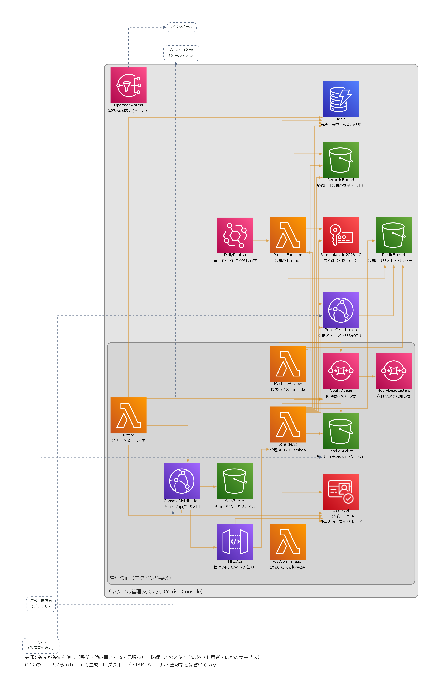
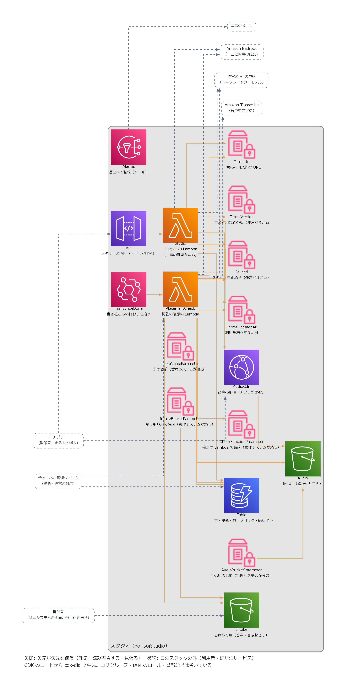
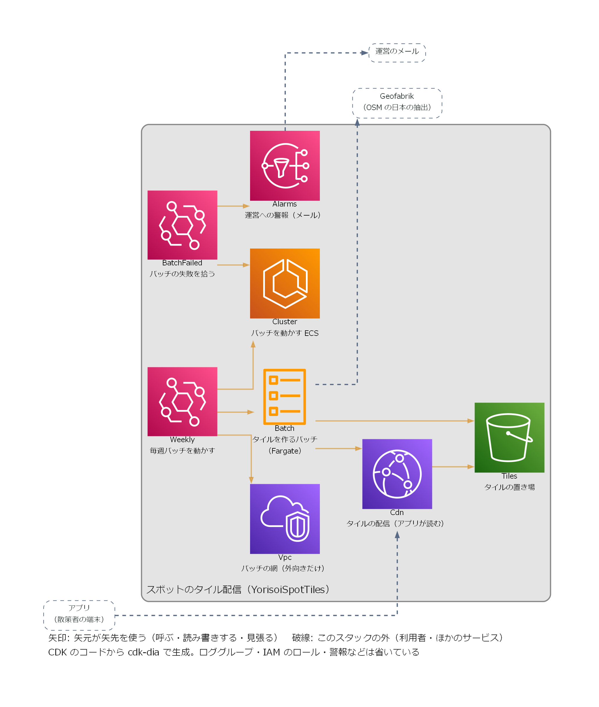

# AWS 資源の図（CDK から生成）

infra の 4 つの CDK アプリを [cdk-dia](https://github.com/pistazie/cdk-dia) で描いた図。CDK のコードから機械的に作るので、**いま配備される資源とそのつながり** がそのまま出る。

- 処理の流れ（誰が何をして、どの順に動くか）は手で描いた [構成図](architecture.md) を見る。この文書は「その流れを支える AWS の資源が、CDK の上で実際にどう組まれているか」を確かめるためのもの
- 4 つのスタックは別々に配備する。管理システム（YorisoiConsole）・AI の中継（YorisoiAiRelay）・スタジオ（YorisoiLocalMaterials）・スポットのタイル（YorisoiSpotTiles）の間に、CDK の上のつながりはない。スタジオは中継の表、管理システムはスタジオの表・バケットを、配備のときに Parameter Store から名前で読む

## 図の読み方

| 見た目 | 意味 |
|---|---|
| アイコン | AWS の資源 1 つ。上の英語は CDK の construct の名前（コードで `new …(this, '名前')` と書いたもの）、下の日本語はその役割 |
| 矢印 | 矢元が矢先を使う（呼ぶ・読み書きする・見張る）。CloudFormation の上の参照から描く |
| 破線の枠と矢印 | このスタックの外（アプリ・ブラウザ・運営のメール・Bedrock・SES・Geofabrik など）とのやりとり |
| 外枠 | スタック。中の枠は CDK の construct（管理システムの「管理の面」は `ConsoleApp`） |
| 並び | 左から右へ。左端が入ってくる人、右へ進むほど使われる側（データ・鍵・設定）、右端が外へ出ていく先 |

矢印の向きは、部品の種類（入口: CloudFront・API Gateway・EventBridge、動くもの: Lambda・ECS、使われるもの: それ以外）と参照の向きから決めている（[infra/tools/diagrams.mjs](../infra/tools/diagrams.mjs) の `arrow`）。データが流れる向きとは限らない。たとえば受付用のバケットにパッケージが届くと機械審査の Lambda が動くが、矢印は「機械審査がバケットを使う」向きに描く。流れの順番は手で描いた [構成図](architecture.md) で読む。外の利用者とサービスは、CDK に現れないので `diagrams.mjs` の `outside` に手で書いている。

主要な図は読みやすくするため、次のものを省いている（画像の下にも凡例として書いてある）。省いたものも含めた全部は各節の「全部の図」で見られる。

- ロググループ・IAM ロール・セキュリティグループ
- CloudWatch の警報（警報の行き先の SNS トピックは残している）・月の予算
- CDK が自分で足す部品（画面のファイルを S3 に置く処理・S3 のイベント通知の処理）
- Cognito のグループとログイン画面の見た目、CloudFront の関数とヘッダーの設定

## 管理システム（YorisoiConsole）

全部の図: [console-all.png](diagrams/console-all.png)

- **管理の面（枠の中）**: 運営・提供者は ConsoleDistribution から画面（WebBucket）と `/api/*` に入る。UserPool でログインし、HttpApi が JWT を確かめて ConsoleApi を呼ぶ。登録した人は PostConfirmation が提供者のグループに入れる
- **申請と審査**: 提供者は IntakeBucket にパッケージを直接置き、届くと MachineReview が審査する。ConsoleApi・MachineReview はどちらも Table に状態を書き、RecordsBucket に見本を残す
- **知らせ**: ConsoleApi は NotifyQueue に知らせを積み、Notify がメールにする。3 回送れなかったものは NotifyDeadLetters に残る
- **公開（枠の外）**: 承認・取り下げのあとと毎日 03:00（DailyPublish）に PublishFunction が動き、Table から承認済みチャンネル・リストを作って SigningKey で署名し、PublicBucket に置く。アプリは PublicDistribution から読む。ConsoleApi も試用チケットの署名に SigningKey を使う
- **警報**: 公開の失敗・2 日公開がない・知らせが送れない、は OperatorAlarms からメールで運営に届く

## AI の中継（YorisoiAiRelay）

全部の図: [relay-all.png](diagrams/relay-all.png)

- アプリは Api（API Gateway の REST API）を呼び、Relay が Bedrock のモデルで語りを作って返す
- Relay は 5 分ごとに Parameter Store の DailyLimit・MonthlyBudget・Model を読む。運営は配備し直さずにこの 3 つを変えられる
- Table は回数・nonce・トークンを持ち、どれも期限で消える
- 予算に近い・止まっている・設定がおかしい・上流のエラー、は Alarms からメールで運営に届く（警報そのものは主要な図では省いている）

## スタジオ（YorisoiLocalMaterials）

全部の図: [studio-all.png](diagrams/studio-all.png)

- アプリは Api（API Gateway の REST API。本番は ApiWaf で送信元ごとに回数を絞る）を中継のトークンで呼び、Studio が一言を置く・区画の一覧・反応・通報・ブロックを Table に読み書きする。一言を置くときは Bedrock で確かめる
- スタジオの音声は、提供者が管理システムの画面から Intake に送る。管理システムが StudioCheck を呼ぶと、長さ・形式を見て Transcribe に文字起こしを頼み、終わりを TranscribeDone が拾って StudioCheck に戻す。Bedrock で確かめて通ったら Audio に写し、アプリは AudioCdn から読む
- 運営は Parameter Store の TermsVersion・TermsUrl・TermsUpdatedAt（一言の利用規約）と Paused（スタジオを止める）を配備し直さずに変えられる。TableNameParameter など 4 つは管理システムが配備のときに読む
- 一言の確認の失敗が続く・設定がおかしい・通報で一言が隠れた・通報でスタジオが止まった、は Alarms からメールで運営に届く

## スポットのタイル（YorisoiSpotTiles）

全部の図: [tiles-all.png](diagrams/tiles-all.png)

- Weekly（EventBridge Scheduler）が毎週 Batch（Fargate のタスク）を Cluster の上で動かす。Batch は Vpc の公開サブネットで外向きの通信だけを使う
- Batch はタイルを作って Tiles に置き、アプリは Cdn から読む
- バッチが失敗する、またはタイルが減りすぎて公開をやめると、BatchFailed（EventBridge のルール）が拾って Alarms から運営にメールする

## 図を作り直す

CDK の資源を足したり名前を変えたりしたら作り直す。

1. [Graphviz](https://graphviz.org/download/) を入れ、`dot` を PATH に通す
2. `npm run diagrams -w infra` を実行する。4 つのアプリを開発用の設定で synth し、`docs/diagrams/` の 8 枚を書き換える。AWS の認証は要らない

日本語の役割・省く資源・枠の名前は [infra/tools/diagrams.mjs](../infra/tools/diagrams.mjs) にある。役割のない資源は英語の名前だけで出るので、新しい資源には役割を足す。
