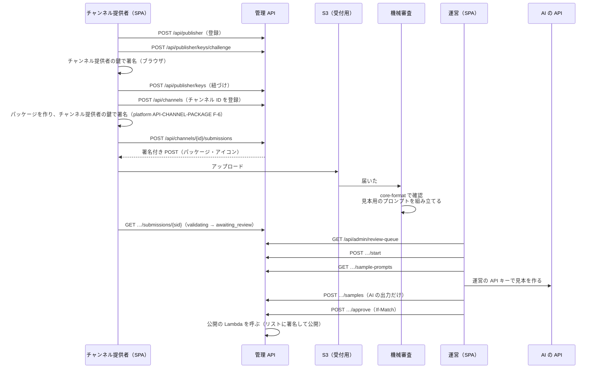

# チャンネル管理システム 管理 API 契約書

## 文書情報

| 項目 | 内容 |
|---|---|
| 文書ID | API-001（yorisoi-console） |
| ドキュメント種別 | API契約書 |
| 対象システム/機能 | チャンネル管理システムの管理 API（SPA と Lambda の間。API Gateway の HTTP API と Cognito） |
| 承認者 | 開発者 |
| ステータス | 承認済 |
| 版 | 1.0 |

入出力の正本は [api/console.openapi.yaml](api/console.openapi.yaml)。本書は方針・状態・エラー・権限を説明し、食い違いがあれば本書に合わせて OpenAPI を直す。

## 目的・背景

[ADR-001](adr/ADR-001-aws-architecture.md) で管理システムの構成を、[DM-001](data-model.md) でデータを決めた。本書は、チャンネル提供者・素材提供者と運営が SPA から使う API を決める。素材提供者の役割と素材集の操作は、[platform ADR-MATERIALS](https://github.com/duwenji/yorisoi-platform/blob/main/docs/decisions/ADR-MATERIALS.md)（素材の素材提供者）による。

この API の利用者は、同じリポジトリの SPA（`web/`）だけ。アプリ（SanpoGuide）はこの API を使わない。アプリが使うのは、公開用の静的ファイル（platform API-CHANNEL-LIST）だけである。

## スコープ・非スコープ

スコープ:
- チャンネル提供者: 登録・退会、鍵の紐づけ、鍵の移し替えの申し出、チャンネルの登録、申請（アップロード）・取り消し、試用チケット、審査の結果と経緯の確認
- 運営: 審査（パッケージ・見本用のプロンプトの取得、見本の保存、判定）、取り下げ、チャンネル提供者の停止・上限、鍵の移し替えの承認、鍵セット・署名鍵の登録、公開の履歴と手動の公開、操作の記録
- 認証・権限、エラー、同時の書き込み、一覧の続き、上限
- 素材提供者: 役割を有効にする、素材集の登録・申請・取り消し・審査の結果の確認、素材集を使っているチャンネルの確認。運営: 素材集の審査（身元の確認を含む）・取り下げ

非スコープ:
- 公開用の静的ファイル（platform API-CHANNEL-LIST）
- Lambda の内部の呼び出し（機械審査・公開。ADR-001 A-10・A-11）
- 通知のメールの文面（実装時に決める。送る出来事と宛先は C-14）

## 対応元ID（トレーサビリティ）

| 対応元ID | 内容 | 対応状況 |
|---|---|---|
| ADR-001 | A-3（HTTP API・JWT）、A-4（Cognito のグループ）、A-5（鍵の紐づけ）、A-11〜A-15、A-18（上限・停止）、D-4（見本はブラウザから） | 本書で API にする |
| DM-001 | AP-01〜AP-22、状態の移り方、M-2（上限）、M-5（版の番号）、M-11（`rev`） | 本書の操作の対応先 |
| platform API-CHANNEL-LIST | `channels[]` の項目（`description`・`tags`・`regions`・`icon`）、試用チケット、鍵セット | 申請の入力・試用チケット・鍵セットの登録 |
| platform API-CHANNEL-PACKAGE | エラーコード、チャンネル提供者の署名 | 機械審査の結果をそのまま返す |
| DM-001 | M-16〜M-25、AP-23〜AP-29 | 本書で API にする |
| platform ADR-MATERIALS・platform API-MATERIALS | D-8・D-9・D-14・D-17〜D-22、素材集の形式、`CollectionReferences` | 本書で API にする。エラーコードは platform API-CHANNEL-PACKAGE・platform API-MATERIALS のもの |

## 方針・決定事項

### 前提の決定

| No. | 論点 | 決定 |
|---|---|---|
| C-1 | 見本用のプロンプトを組み立てる場所 | 機械審査の Lambda が、アプリのプロンプト・パック（`PromptTemplates` とプロンプトのファイル）で場面ごとのプロンプトを組み立てる。SPA はそれを AI に送るだけ。アプリと同じ組み立て方になる |
| C-2 | エラーの形 | RFC 9457（`application/problem+json`）に `code` を足す。platform の [API-SECRET-MESSAGES](https://github.com/duwenji/yorisoi-platform/blob/main/docs/contracts/API-SECRET-MESSAGES.md) と同じ |
| C-3 | 契約の正本 | 本書と OpenAPI 3.1。SPA と Lambda の型は OpenAPI から作る |
| C-4 | チャンネル提供者の退会 | チャンネル提供者が自分で退会できる。公開中のチャンネルはすべて取り下げ、Cognito のユーザーと連絡先を消す。操作の記録、アカウントIDの予約、チャンネルIDは残す（再利用させない） |
| C-14 | チャンネル提供者への通知 | 判定（承認・差し戻し・却下）、取り下げ、鍵の移し替えの結果（承認・認めない）を、チャンネル提供者にメールで知らせる。送るのは Amazon SES（ADR-001 A-19）。宛先は Cognito で確認済みのメールアドレス（`contact` ではない）。本文には理由と画面へのリンクだけを入れ、見本・運営の `sub` は入れない。メールが送れなくても操作は成功させ、送信の結果は操作の記録に残す |

### 設計の決定

| No. | 論点 | 決定案 |
|---|---|---|
| C-5 | 置き場所 | SPA と同じ CloudFront の `/api/*` を API Gateway に送る。同じオリジンなので CORS が要らない |
| C-6 | 形 | リソースに対する REST。状態を変える操作は `POST …/{動詞}`（例: `/approve`）。版の番号を URL に入れない（SPA と API は一緒に配備する） |
| C-7 | 認証 | `Authorization: Bearer {Cognito のアクセストークン}`。API Gateway の JWT オーソライザーで確かめ、Lambda でグループ（`cognito:groups`）を確かめる。`/api/admin/*` は `operator` だけ |
| C-8 | 同時の書き込み | 状態が変わるもの（チャンネル提供者・チャンネル・申請・鍵の移し替え）は、応答に `ETag`（DM-001 の `rev`）を付ける。それを変える操作は `If-Match` が必須で、ないと 428、違うと 412 |
| C-9 | 一覧の続き | `?cursor=…&limit=…`。応答の `nextCursor` は中身の読めない文字列（DynamoDB の続きの位置を暗号化したもの）。`limit` は 1〜100、既定は 20 |
| C-10 | アップロード | 申請を作ると、パッケージ（2MB まで）とアイコン（100KB まで）の S3 の署名付き POST を返す。大きさの上限は S3 が強制する。有効期限は 15 分。1 時間届かなければ申請は `expired` |
| C-11 | 鍵の移し替えの単位 | チャンネル提供者ごとにする（DM-001 ではチャンネルごと）。チャンネル提供者が使う鍵は 1 つなので、すべてのチャンネルが一緒に移る。DM-001 を 1.1 に改める |
| C-12 | 運営が見られる範囲 | 運営は `/api/admin/*` のほか、チャンネル提供者向けの読み取りの操作（`GET /api/channels/{channelId}` など）も、どのチャンネル提供者のものでも呼べる |
| C-13 | 秘密を送らない | AI の API キー、チャンネル提供者の秘密鍵は、どの操作にも含めない。見本は AI の出力だけを保存する |

### 素材の素材提供者の決定

| No. | 論点 | 決定 |
|---|---|---|
| C-15 | 役割とパス | アカウントは `/api/publisher` を共通に使う（M-16）。素材提供者の役割は `POST /api/publisher/roles/producer` で有効にする。素材集の操作とスタジオを出す承認の申し込みには `producer` の役割が要る（ないと `role_required`。REQ-STUDIO D-14）。Cognito のグループは今の `publisher` のまま（役割はアカウントの項目で見る） |
| C-16 | 素材集の操作 | `/api/collections/…` に、チャンネルと同じ形の操作を置く（登録・一覧・申請・取り消し）。試用チケットとアイコンはない（M-19）。運営の操作は `/api/admin/collections/…` に、チャンネルと同じ判定・取り下げを置く。審査待ちの一覧（`/api/admin/review-queue`）は共通で、項目の `kind` で見分ける |
| C-17 | 身元の確認（D-20・M-17） | アカウントに身元の記録がないうちは、素材集の `approve` の要求に `verification`（`method`・`detail`）が必須。記録があれば省ける。記録がなく `verification` もないときは `producer_not_verified`。記録の中身は運営だけが見られる（本人には「確認済みか」だけ） |
| C-18 | 使っているチャンネル（D-18） | `GET /api/collections/{collectionId}/used-by` で、利用の記録（M-22）を返す。素材提供者と運営が見られる。返すのはチャンネルの ID・名前・版・チャンネル提供者の表示名・参照している素材の ID（どれもリストに載っている内容） |
| C-19 | 機械審査の結果 | チャンネルの `validation` に `collections`（宣言した素材集ごとの解決の結果。`CollectionReferences` の状態とエラーコード）を足す。素材集の `validation` に `external`（外部の素材ごとの確認。M-20）・`inUse`（D-8 で拒んだ理由。M-22）・`warnings`（拒まないが知らせること。例: 利用許諾の縮小で使えなくなるチャンネル）を足す |
| C-20 | 通知（C-14 に追加） | 素材集の判定・取り下げ、外部の素材の確認で見つかった不具合（M-21）を素材提供者に知らせる。素材集の取り下げ・新しい版の承認・利用許諾の縮小を、利用の記録にあるチャンネル提供者に知らせる（D-18）。宛先と送り方は C-14 と同じ |
| C-21 | 段と版の対応表 | CDK のコンテキスト（環境ごとの設定ファイル）に置き、変えるときは PR を通して配備する。運営の画面からは変えない。アプリの素材の第 1 段の版が決まるまでは、どの段も仮の大きな値にする |
| C-22 | 退会（素材提供者） | 退会では、公開中の素材集もすべて取り下げる（理由は「素材提供者が退会したため」）。素材集の審査待ちの申請も取り消す |

### エコシステムの決定

DES-011 による。

| No. | 論点 | 決定 |
|---|---|---|
| C-24 | 申請・チャンネル・素材集の表示（DES-011 N-9） | 申請（`Submission`）に `activities`・`genres`・`requires`（機械審査の後）・`offeredIn`（このチャンネルが出るアプリの ID）。チャンネルに `offeredIn`。`latestApproved` に `activities`・`genres`・`requires`・`minAppVersions`。素材集の `latestApproved` に `grants.apps`・`minAppVersions` |
| C-25 | 機械審査（DES-011 N-8） | 見本は `activities` の代表のアプリのプロンプト・パックで作る（`walk` は SanpoGuide、`cycle` は CycleGuide、両方なら両方）。代表のアプリがない過ごし方だけのチャンネルは、`sample-prompts` の応答の `scenarios` が空で `noRepresentativeApp`（チャンネルの `activities`）が付く |
| C-27 | 設定（C-21 の改訂。DM-001 M-27） | CDK の環境ごとの設定に、アプリの ID ごとの `appStageVersions` を置く。変えるときは PR を通して配備する。運営の画面からは変えない |

### 全体の流れ



## エンドポイント一覧

権限: P = チャンネル提供者（`publisher` のグループで、自分のもの）、O = 運営（`operator`）、本人 = ログインしていれば誰でも

### チャンネル提供者

| メソッド | パス | 権限 | 概要 | DM-001 |
|---|---|---|---|---|
| GET | `/api/me` | 本人 | ログインしているユーザー、役割、チャンネル提供者 | AP-01 |
| POST | `/api/publisher` | 本人 | チャンネル提供者として登録（`pending_key`） | — |
| GET | `/api/publisher` | P | 自分のチャンネル提供者 | AP-02 |
| PATCH | `/api/publisher` | P | 表示名・連絡先の変更（If-Match） | — |
| DELETE | `/api/publisher` | P | 退会（If-Match）。C-4 | — |
| POST | `/api/publisher/keys/challenge` | P | 鍵の紐づけ用の一度きりの文字列 | AP-22 |
| POST | `/api/publisher/keys` | P | 最初の鍵を紐づける | AP-04 |
| GET | `/api/publisher/keys` | P | 鍵の一覧（今のものと過去のもの） | AP-03 |
| POST | `/api/publisher/key-transfers` | P | 新しい鍵を紐づけて、移し替えを申し出る | — |
| GET | `/api/publisher/key-transfers` | P | 移し替えの申し出の一覧 | — |
| POST | `/api/publisher/key-transfers/{transferId}/cancel` | P | 申し出を取り消す（If-Match） | — |
| GET | `/api/publisher/history` | P | 自分のチャンネル提供者・チャンネルの経緯（操作の記録のうちチャンネル提供者に見せるもの） | AP-19 |
| POST | `/api/channels` | P | チャンネル ID を登録 | — |
| GET | `/api/channels` | P | 自分のチャンネルの一覧 | AP-05 |
| GET | `/api/channels/{channelId}` | P・O | チャンネル | AP-06 |
| POST | `/api/channels/{channelId}/submissions` | P | 申請を作り、アップロード先を受け取る | AP-17 |
| GET | `/api/channels/{channelId}/submissions` | P・O | 申請の一覧（新しい順） | AP-07 |
| GET | `/api/channels/{channelId}/submissions/{submissionId}` | P・O | 申請（機械審査の結果、判定と理由） | AP-07・08 |
| POST | `/api/channels/{channelId}/submissions/{submissionId}/withdraw` | P | 申請を取り消す（If-Match） | — |
| POST | `/api/channels/{channelId}/submissions/{submissionId}/test-tickets` | P | 試用チケットを発行 | AP-16・17 |
| GET | `/api/channels/{channelId}/submissions/{submissionId}/test-tickets` | P | 試用チケットの一覧 | AP-16 |

### 素材提供者

権限: R = 素材提供者の役割を持つアカウント（自分のもの）

| メソッド | パス | 権限 | 概要 | DM-001 |
|---|---|---|---|---|
| POST | `/api/publisher/roles/producer` | P | 素材提供者の役割を有効にする（If-Match）。C-15 | M-16・M-17 |
| POST | `/api/collections` | R | 素材集 ID を登録 | M-18・M-19 |
| GET | `/api/collections` | R | 自分の素材集の一覧 | AP-23 |
| GET | `/api/collections/{collectionId}` | R・O | 素材集 | AP-24 |
| GET | `/api/collections/{collectionId}/used-by` | R・O | 素材集を使っているチャンネル。C-18 | AP-28 |
| POST | `/api/collections/{collectionId}/submissions` | R | 申請を作り、アップロード先を受け取る | AP-17 |
| GET | `/api/collections/{collectionId}/submissions` | R・O | 申請の一覧（新しい順） | AP-25 |
| GET | `/api/collections/{collectionId}/submissions/{submissionId}` | R・O | 申請（機械審査の結果、判定と理由） | AP-25 |
| POST | `/api/collections/{collectionId}/submissions/{submissionId}/withdraw` | R | 申請を取り消す（If-Match） | — |

### 運営

| メソッド | パス | 概要 | DM-001 |
|---|---|---|---|
| GET | `/api/admin/review-queue` | 審査待ち（古い順） | AP-09 |
| GET | `/api/admin/channels/{channelId}/submissions/{submissionId}/package` | パッケージ・アイコンの取得先（署名付き URL、5 分） | — |
| GET | `/api/admin/channels/{channelId}/submissions/{submissionId}/sample-prompts` | 見本用のプロンプト（場面ごと） | — |
| POST | `/api/admin/channels/{channelId}/submissions/{submissionId}/samples` | AI に話させた見本を保存 | — |
| GET | `/api/admin/channels/{channelId}/submissions/{submissionId}/reviews` | 審査の記録（見本を含む） | AP-08 |
| POST | `/api/admin/channels/{channelId}/submissions/{submissionId}/start` | 審査を始める（If-Match） | — |
| POST | `/api/admin/channels/{channelId}/submissions/{submissionId}/release` | 審査を戻す（If-Match） | — |
| POST | `/api/admin/channels/{channelId}/submissions/{submissionId}/approve` | 承認（If-Match） | — |
| POST | `/api/admin/channels/{channelId}/submissions/{submissionId}/return` | 差し戻し（If-Match） | — |
| POST | `/api/admin/channels/{channelId}/submissions/{submissionId}/reject` | 却下（If-Match） | — |
| POST | `/api/admin/channels/{channelId}/revoke` | 取り下げ（If-Match） | AP-11 |
| GET | `/api/admin/publishers` | チャンネル提供者の一覧（`?status=`） | AP-20 |
| GET | `/api/admin/publishers/{publisherId}` | チャンネル提供者 | AP-02 |
| GET | `/api/admin/publishers/{publisherId}/channels` | チャンネル提供者のチャンネル | AP-05 |
| POST | `/api/admin/publishers/{publisherId}/suspend` | 停止（If-Match） | — |
| POST | `/api/admin/publishers/{publisherId}/resume` | 停止を解く（If-Match） | — |
| PUT | `/api/admin/publishers/{publisherId}/limits` | 上限を変える（If-Match） | — |
| GET | `/api/admin/key-transfers` | 移し替えの申し出（`?state=requested`） | AP-12 |
| POST | `/api/admin/publishers/{publisherId}/key-transfers/{transferId}/approve` | 移し替えを承認（If-Match） | — |
| POST | `/api/admin/publishers/{publisherId}/key-transfers/{transferId}/reject` | 移し替えを認めない（If-Match） | — |
| GET | `/api/admin/signing-keys` | 署名鍵の一覧 | AP-15 |
| POST | `/api/admin/signing-keys` | KMS の鍵を署名鍵として登録 | — |
| GET | `/api/admin/keysets` | 鍵セットの履歴 | AP-15 |
| POST | `/api/admin/keysets` | ルート鍵が署名した鍵セットを登録 | AP-15 |
| GET | `/api/admin/publications` | 公開の履歴 | AP-14 |
| POST | `/api/admin/publications` | 今すぐ作り直して公開する | AP-13 |
| GET | `/api/admin/audit` | 操作の記録（`?month=` または `?target=`） | AP-18・19 |
| GET | `/api/admin/collections/{collectionId}/submissions/{submissionId}/package` | 素材集のパッケージの取得先（署名付き URL、5 分） | — |
| GET | `/api/admin/collections/{collectionId}/submissions/{submissionId}/reviews` | 審査の記録 | — |
| POST | `/api/admin/collections/{collectionId}/submissions/{submissionId}/start` | 審査を始める（If-Match） | — |
| POST | `/api/admin/collections/{collectionId}/submissions/{submissionId}/release` | 審査を戻す（If-Match） | — |
| POST | `/api/admin/collections/{collectionId}/submissions/{submissionId}/approve` | 承認（If-Match）。C-17 | — |
| POST | `/api/admin/collections/{collectionId}/submissions/{submissionId}/return` | 差し戻し（If-Match） | — |
| POST | `/api/admin/collections/{collectionId}/submissions/{submissionId}/reject` | 却下（If-Match） | — |
| POST | `/api/admin/collections/{collectionId}/revoke` | 取り下げ（If-Match） | AP-27 |
| GET | `/api/admin/publishers/{publisherId}/collections` | アカウントの素材集 | AP-23 |

## リクエスト・レスポンス仕様

項目の詳細は OpenAPI。ここでは判断が要るところだけを書く。

共通の決まり:
- 文字コードは UTF-8、日時は UTC の ISO 8601（ミリ秒まで）、ID は ULID（チャンネル ID は platform API-CHANNEL-LIST の書式）
- 知らない項目は無視する。応答への項目の追加は互換性のある変更
- 状態が変わるものの応答には、本文の `rev` と同じ値の `ETag`（`"{rev}"`）を付ける

### POST /api/publisher/keys/challenge → POST /api/publisher/keys

```json
// 応答（challenge）
{ "nonce": "01J…", "message": "yorisoi-console:bind-key:01J…:{publisherId}", "expiresAt": "…" }
// 要求（keys）
{ "nonce": "01J…", "publicKey": "<base64url 32 バイト>", "signature": "<base64url(message の UTF-8 への Ed25519 署名)>" }
```

- 一度きりの文字列は 10 分で切れ、1 回しか使えない
- サーバーは公開鍵からアカウントID（`sg1…`）を計算し、署名を確かめて紐づける。チャンネル提供者は `active` になる
- すでに鍵があるチャンネル提供者は、この操作では紐づけられない（`key_already_bound`）。鍵を替えるときは移し替え（C-11）

### POST /api/publisher/key-transfers

要求は鍵の紐づけと同じ 3 項目に、`reason`（`lost` / `leaked` / `other`）、`publicReason`（散策者に見せる文、1〜60 文字）、`note`（運営への説明）を足したもの。新しい鍵は「移し替え待ち」として紐づき、運営が承認すると今の鍵になる。申し出ている間は、新しい申請を受け付けない（`transfer_pending`）。

### POST /api/channels/{channelId}/submissions

```json
// 要求
{ "description": "…", "tags": ["history"], "regions": ["xn7"], "note": "運営への説明" }
// 応答 201
{
  "submission": { "submissionId": "01J…", "state": "uploading", "rev": 1, … },
  "uploads": {
    "package": { "url": "https://…s3…", "fields": { "key": "…", "policy": "…", … }, "maxBytes": 2097152 },
    "icon":    { "url": "https://…s3…", "fields": { … }, "maxBytes": 102400 }
  },
  "uploadExpiresAt": "…"
}
```

- `name`・`summary`・`lang`・`version` はパッケージの `channel.json` から機械審査が読む。この要求には含めない
- 受け付けるのは、チャンネル提供者が `active`、移し替えの申し出がない、チャンネルが自分のもの、審査待ちの申請がない（DM-001 M-2）、今日の申請の数が上限の内、のとき
- 両方のファイルが届いたら機械審査が始まる（`validating`）。結果は `validation` に入る。不合格なら `validation_failed`
- 機械審査では、platform API-CHANNEL-PACKAGE の確認（ADR-001 A-11）に加えて、次を確かめる: アイコンが PNG で 256×256 以下、`channel.json` の `id` がこのチャンネル、`publisher` がチャンネル提供者の今の鍵、`version` が最後に承認した版より大きい（M-5）

### POST /api/collections/{collectionId}/submissions

```json
// 要求
{ "note": "運営への説明" }
// 応答 201
{
  "submission": { "kind": "collection", "submissionId": "01J…", "collectionId": "kamakura-audio-guide", "state": "uploading", "rev": 1, … },
  "uploads": { "package": { "url": "https://…s3…", "fields": { … }, "maxBytes": 2097152 } },
  "uploadExpiresAt": "…"
}
```

- 受け付けるのは、アカウントが `active` で素材提供者の役割を持つ、移し替えの申し出がない、素材集が自分のもの、審査待ちの申請がない、今日の申請の数（チャンネルと合わせて数える。M-19）が上限の内、のとき
- 機械審査では、platform API-MATERIALS の確かめる手順 1（`CollectionValidator`）に加えて、次を確かめる: `collection.json` の `id` がこの素材集、`producer` がアカウントの今の鍵、`version` が最後に承認した版より大きい（M-5）、外部の素材の大きさと SHA-256（M-20）、利用の記録にある素材の ID が残り種類が変わっていない（D-8・M-22。`inUse` に理由）。利用許諾を狭めて使えなくなるチャンネルがあれば `warnings` に出す（拒まない）

### 機械審査の結果（素材と素材集）

```json
// チャンネルの申請の validation
{ "ok": false, "appStage": 2,
  "collections": [ { "as": "kamakura", "collectionId": "kamakura-audio-guide", "status": "unusable", "code": "not_granted", "detail": "…" } ],
  "errors": [ { "code": "not_granted", "detail": "kamakura: …" } ], … }
// 素材集の申請の validation
{ "ok": false, "appStage": 2,
  "external": [ { "resourceId": "hachimangu-audio", "ok": false, "detail": "sha256 differs" } ],
  "inUse": [ { "channelId": "kamakura-history", "resourceId": "old-photo", "detail": "removed" } ],
  "warnings": [ { "code": "grants_narrowed", "detail": "kamakura-history can no longer use it" } ],
  "errors": [ { "code": "resource_mismatch", "detail": "…" }, { "code": "resource_in_use", "detail": "…" } ], … }
```

- チャンネルの `collections[].status` は `usable` / `unusable`（`CollectionReferences` の結果。機械審査は、その時点で公開中の素材集を読んで解決するので `not_fetched` は出ない）。1 つでも `unusable` があれば不合格（platform API-CHANNEL-PACKAGE 手順 9a）
- 承認のときに、チャンネルは素材集をもう一度解決し、素材集は D-8 をもう一度確かめる。通らなければ `409 resource_in_use`（素材集）または `409 invalid_state`（チャンネル。`detail` に理由）

### POST /api/admin/collections/{collectionId}/submissions/{submissionId}/approve

```json
{ "message": "…", "verification": { "method": "登録済みの連絡先への電話", "detail": "鎌倉市観光協会の代表番号から本人と確認" } }
```

- アカウントに身元の記録（`producerVerification`）がなければ `verification` が必須（C-17）。あれば省け、送っても上書きしない（表示名を変えて記録が消えたときだけ書く）
- 承認すると、`tags`・`regions`・`media`・`resourcesSize`・`grants`・`minAppVersions` を計算して `latestApproved` に写し（M-24）、公開の Lambda を呼ぶ。利用の記録にあるチャンネル提供者に知らせる（C-20）

### POST …/test-tickets

機械審査に合格した申請（`awaiting_review`・`in_review`・`returned`・`approved`）だけ。応答は、署名済みのチケット（platform API-CHANNEL-LIST の形）と、QR コードにする文字列。SPA が QR コードを描く。

### GET /api/admin/…/sample-prompts

```json
{
  "generatedBy": "core-format 2.15.0, sanpoguide prompts 4.2.0, cycleguide prompts 0.1.0",
  "scenarios": [
    { "id": "start-morning-sunny", "label": "散歩の開始（朝・晴れ）", "system": "…", "user": "…" },
    { "id": "guide-temple", "label": "初めてのスポットの解説（寺社）", "system": "…", "user": "…" }
  ]
}
```

場面は審査基準 2.7 の表のとおり。プロンプトは機械審査の Lambda がプロンプト・パックで組み立てて記録用のバケットに置いたもの（C-1）。

### POST /api/admin/…/samples

```json
{ "service": "anthropic", "model": "claude-…", "items": [ { "scenarioId": "start-morning-sunny", "output": "…" } ] }
```

AI の出力だけを保存する（C-13）。応答の `samplesId` を判定の要求に付けると、審査の記録に結び付く。本文は 1MB まで。

### 判定（approve / return / reject）

```json
// return・reject の要求
{ "findings": [ { "item": "2.2", "detail": "…" } ], "message": "チャンネル提供者への説明", "samplesIds": ["01J…"] }
// approve の要求
{ "samplesIds": ["01J…"], "message": "…" }
```

- `start` した担当者でなくても判定できる（運営の担当者が 1 人のうちは区別しない）。状態は `in_review` であること
- `approve` は、版の番号が最後に承認した版より大きいことを、もう一度確かめる（M-5）。そのあと公開の Lambda を非同期で呼ぶ。応答の `publication` は `pending`
- `return`・`reject` は `findings` が 1 件以上必須

### POST /api/admin/channels/{channelId}/revoke

```json
{ "versions": [3], "reason": "散策者に見せる理由", "severity": "high" }
```

`versions` を省くとすべての版。公開の Lambda を呼ぶ。

### DELETE /api/publisher（退会）

要求の本文に `{ "confirm": "{publisherId}" }` を必須にする（打ち間違い防止）。処理: 公開中のチャンネルをすべて取り下げ（理由は「チャンネル提供者が退会したため」）、公開中の素材集をすべて取り下げ（理由は「素材提供者が退会したため」。C-22）、審査待ちの申請を取り消し、移し替えの申し出を取り消し、チャンネル提供者を `deleted` にして表示名・連絡先を消し、Cognito のユーザーを消す。応答 204。

### POST /api/admin/keysets

```json
{ "document": { "payload": "…", "keyId": "sc1…", "sig": "…" } }
```

ルート鍵（設定に固定した公開鍵）の署名、`type`・`provider`、`seq` が今より大きいこと、載っている署名鍵が登録済みであることを確かめて登録し、公開の Lambda を呼ぶ。

## エラー表

```json
{ "type": "about:blank", "title": "Quota exceeded", "status": 429, "code": "quota_exceeded", "detail": "uploads per day: 20", "errors": [] }
```

`errors` は入力の誤りのときだけ（`[{ "path": "/tags/0", "message": "…" }]`）。

| HTTP | code | 発生条件 | SPA の動き |
|---|---|---|---|
| 400 | `invalid_request` | JSON の形式・必須項目・値の範囲の誤り | `errors` を項目の横に出す |
| 400 | `invalid_signature` | 鍵の紐づけ・鍵セットの署名が合わない | 署名をやり直すよう出す |
| 400 | `challenge_invalid` | 一度きりの文字列が切れた・使用済み・知らない | 取り直してやり直す |
| 400 | `keyset_invalid` | 鍵セットの `type`・`provider`・`seq`・署名鍵が合わない | 理由を出す |
| 401 | `unauthorized` | トークンがない・切れた（API Gateway が返す） | トークンを更新して 1 回だけ再送。だめならログインへ |
| 403 | `forbidden` | 役割が違う、他のチャンネル提供者のもの | 画面を出さない |
| 403 | `publisher_not_active` | チャンネル提供者が `pending_key` か `suspended` | 状態と理由を出す |
| 403 | `role_required` | 素材提供者の役割がないアカウントが、素材集の操作か、スタジオを出す承認の申し込みをした（C-15） | 役割を有効にする画面へ案内 |
| 404 | `not_found` | ないもの | 一覧へ戻す |
| 409 | `already_registered` | チャンネル提供者として登録済み | チャンネル提供者の画面へ |
| 409 | `channel_id_taken` | チャンネル ID が使われている（取り下げ済み・退会済みを含む） | 別の ID を促す |
| 409 | `collection_id_taken` | 素材集 ID が使われている（取り下げ済み・退会済みを含む。チャンネルの ID とは別に数える） | 別の ID を促す |
| 409 | `producer_not_verified` | 身元の記録がないアカウントの素材集を、`verification` なしで承認しようとした（C-17） | 確認の欄を出す |
| 409 | `resource_in_use` | 承認のときに、公開中のチャンネルが参照している素材を消した・種類を変えたと分かった（D-8・M-22） | 差し戻しを促す |
| 409 | `account_id_taken` | その鍵のアカウントIDが、使われている・使われていた（DM-001 M-7） | 別の鍵を促す |
| 409 | `key_already_bound` | すでに鍵があるチャンネル提供者が、最初の紐づけをしようとした | 移し替えへ案内 |
| 409 | `transfer_pending` | 移し替えの申し出の間に申請しようとした、2 つめの申し出 | 状態を出す |
| 409 | `limit_reached` | チャンネル・素材集の数の上限（M-2・M-19） | 上限を出す |
| 409 | `pending_submission_exists` | そのチャンネルに審査待ちの申請がある | その申請へ案内 |
| 409 | `invalid_state` | 今の状態ではできない操作（`detail` に今の状態） | 取り直して画面を更新 |
| 409 | `version_not_newer` | 版の番号が最後に承認した版以下（承認時） | 差し戻しを促す |
| 412 | `precondition_failed` | `If-Match` が今の `rev` と違う | 取り直して、変更を確かめてもらう |
| 428 | `precondition_required` | `If-Match` がない | 不具合として記録 |
| 413 | `payload_too_large` | 本文が上限を超えた（見本 1MB など） | 理由を出す |
| 429 | `quota_exceeded` | 1 日の申請・試用チケットの上限（M-2） | 上限と、日本時間の 0 時に戻ることを出す |
| 429 | `throttled` | 流量の制限（API Gateway・WAF） | 少し待って再送 |
| 500 | `internal` | サーバーの不具合 | 再送を促す。`instance` を問い合わせ用に出す |

## 権限とデータの見え方

| データ | チャンネル提供者 | 運営 |
|---|---|---|
| 申請の機械審査の結果 | 見える | 見える |
| 判定と `findings`・`message` | 見える | 見える |
| 審査の記録の運営・見本 | 見えない | 見える |
| 操作の記録 | 自分のチャンネル提供者・チャンネルの、チャンネル提供者に見せる操作だけ（運営の `sub` は出さず「運営」と出す） | すべて |
| 他のチャンネル提供者のもの | 見えない（`404`。存在を明かさない） | 見える |
| 身元の確認の記録の中身 | 見えない（「確認済みか」だけ） | 見える |
| 素材集を使っているチャンネル | 自分の素材集のぶん（リストに載っている内容だけ） | すべて |

## 確認観点

| No. | 観点 |
|---|---|
| CV-01 | OpenAPI と本書のエンドポイント・エラーコードが一致する（CI で確かめる） |
| CV-02 | `/api/admin/*` は `operator` 以外に 403、他のチャンネル提供者のものは 404 |
| CV-03 | `If-Match` がないと 428、古いと 412。2 人が同時に判定しても片方だけが成功する |
| CV-04 | 鍵の紐づけ: 切れた・使用済みの一度きりの文字列、違う鍵の署名、使われたアカウントIDを、それぞれのエラーで拒む |
| CV-05 | 申請: 上限（チャンネル数、審査待ち、1 日の数）を同時の要求でも超えない |
| CV-06 | アップロード: 2MB・100KB を超えるファイルを S3 が拒み、1 時間届かない申請が `expired` になる |
| CV-07 | 機械審査: `id`・`publisher`・`version`・アイコンの不一致が `validation_failed` になり、platform API-CHANNEL-PACKAGE のエラーコードが返る |
| CV-08 | 状態の移り方: DM-001 の図にない移り方はすべて `invalid_state` |
| CV-09 | 承認・取り下げ・移し替えの承認・鍵セットの登録のあと、リストが作り直される |
| CV-10 | 退会: チャンネルが取り下げられ、チャンネル ID とアカウントIDが再利用できない |
| CV-11 | 応答・操作の記録・ログに、AI の API キー、トークン、秘密鍵が含まれない |
| CV-12 | チャンネル提供者に、運営の `sub` と見本が見えない |
| CV-14 | 素材提供者の役割がないアカウントの素材集の操作が `role_required`、他のアカウントの素材集が 404 |
| CV-15 | 素材集の申請: 素材集の数の上限、審査待ち 1 つ、チャンネルと合わせた 1 日の数を、同時の要求でも超えない |
| CV-16 | 素材集の機械審査: `id`・`producer`・`version`・外部の素材のハッシュ・D-8 の違反が `validation_failed` になり、`external`・`inUse` に理由が出る。利用許諾の縮小は `warnings` に出て合格する |
| CV-17 | 身元の記録がないアカウントの素材集の承認は `verification` が必須で、記録が残る。表示名を変えると記録が消える |
| CV-18 | チャンネルの機械審査: 宣言した素材集が載っていない・利用許諾がない・素材がないとき、`collections` に理由が出て不合格になる |
| CV-19 | 素材集の承認・取り下げで、使っているチャンネル提供者にメールが 1 通ずつ届き、素材提供者にも判定が届く |
| CV-20 | 退会で、公開中の素材集も取り下げられ、素材集 ID が再利用できない |
| CV-13 | 承認・差し戻し・却下・取り下げ・移し替えの承認・認めないのそれぞれで、チャンネル提供者の確認済みのメールアドレスに 1 通だけ届く。SES が失敗しても操作は成功し、再送のあと失敗が操作の記録に残る。本文に見本・運営の `sub`・トークンが含まれない |

## 互換性方針・移行メモ

- 利用者は同じリポジトリの SPA だけ。配備は「API → SPA」の順にし、API の変更は項目・操作・エラーコードの追加だけにする（追加なら古い SPA が動き続ける）
- 項目の削除・意味の変更が要るときは、新しい項目を足して SPA を移し、次の配備で古い項目を消す（2 回に分ける）

## 制約

- API Gateway の HTTP API の本文は 10MB まで、Lambda の応答は 6MB まで。パッケージは本文で送らず S3 に直接上げる
- HTTP API には AWS WAF を直接付けられない。流量の制限は API Gateway のルートごとの制限と、Cognito に付けた WAF（ADR-001 A-18）で行う

## 未決事項・リスク

| No. | 内容 | 決める時期 |
|---|---|---|
| 1 | 鍵の移し替えの本人確認で、何を「鍵とは別の経路」とするか（ADR-001 未決事項 No.5）。API では運営が `verification` に自由に書く | 運用の開始前 |
| 2 | チャンネル提供者向けの API（CI からの申請。ADR-001 未決事項 No.2） | 要望が出たとき |

## 関連ドキュメント・参照リンク

- [api/console.openapi.yaml](api/console.openapi.yaml): 入出力の正本
- [ADR-001](adr/ADR-001-aws-architecture.md): AWS の構成
- [DM-001](data-model.md): データモデル
- [platform API-CHANNEL-LIST](https://github.com/duwenji/yorisoi-platform/blob/main/docs/contracts/API-CHANNEL-LIST.md)・[platform API-CHANNEL-PACKAGE](https://github.com/duwenji/yorisoi-platform/blob/main/docs/contracts/API-CHANNEL-PACKAGE.md)・[platform チャンネル審査方針](https://github.com/duwenji/yorisoi-platform/blob/main/docs/policies/channel-review.md)
- [RFC 9457](https://www.rfc-editor.org/rfc/rfc9457): Problem Details for HTTP APIs
- [platform ADR-MATERIALS](https://github.com/duwenji/yorisoi-platform/blob/main/docs/decisions/ADR-MATERIALS.md)・[platform API-MATERIALS](https://github.com/duwenji/yorisoi-platform/blob/main/docs/contracts/API-MATERIALS.md)
