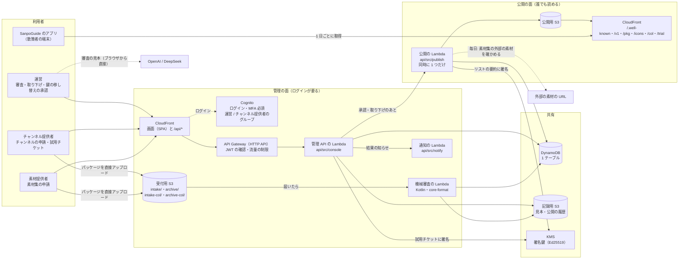
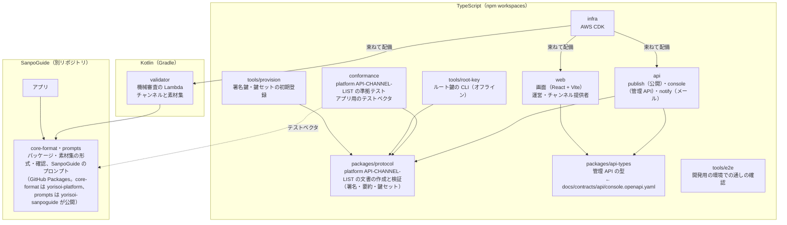
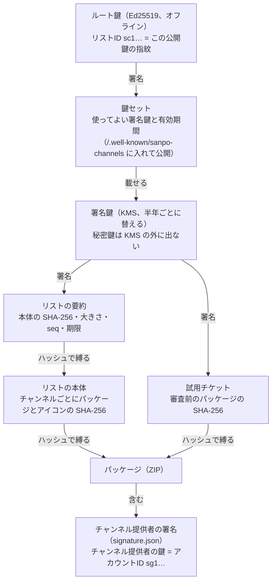
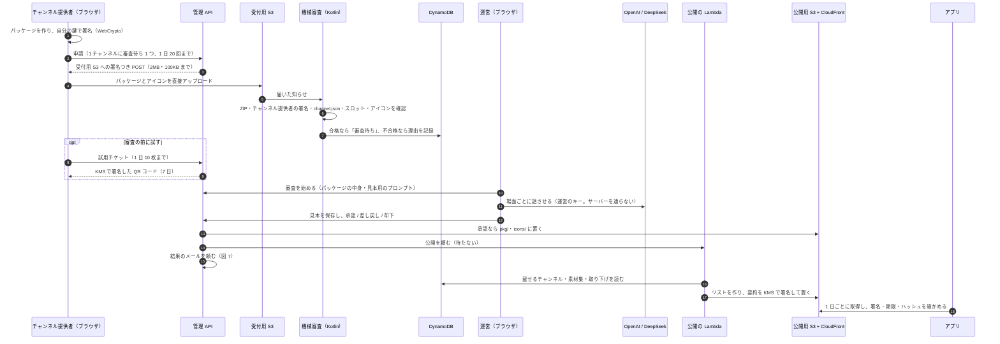
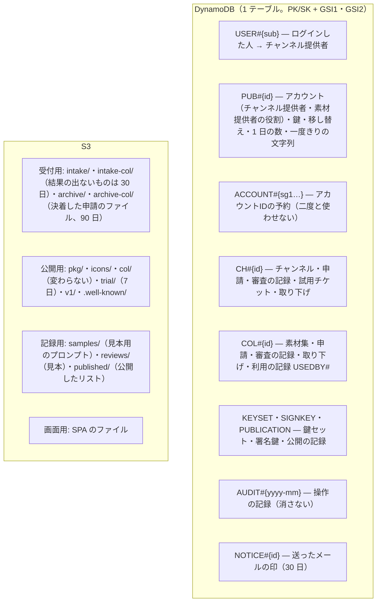
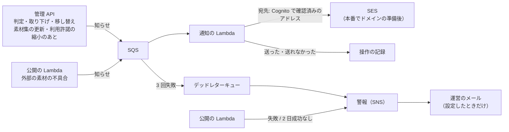
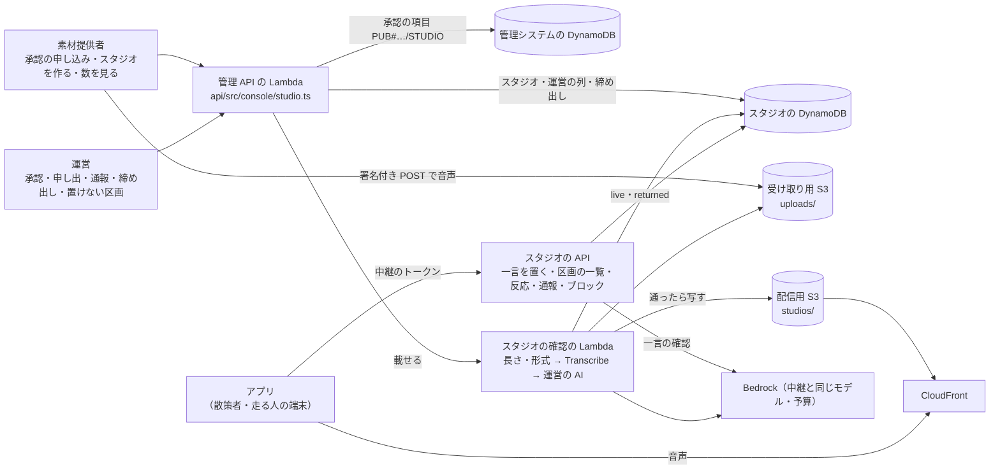
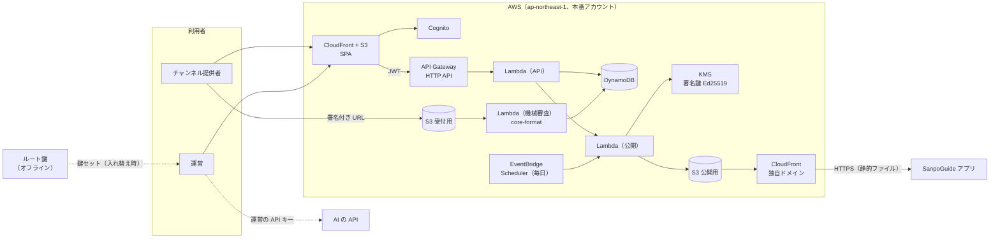

# チャンネル管理システムの構成図

| 項目 | 内容 |
|---|---|
| 文書ID | ARCH-001 |
| ステータス | 承認済 |

yorisoi-console を 9 枚の図で説明する。図 1 で「誰が何を使い、どこに何があるか」をつかみ、図 2〜3 でリポジトリと信頼の仕組み、図 4〜8 で申請から公開まで・公開の処理・データの置き場所・メールと警報・環境を追い、図 9 でその場の素材（スタジオ・一言）の管理を見る。

- 何をするシステムか: SanpoGuide のアプリに第三者のチャンネルと素材集を届けるため、チャンネル提供者・素材提供者の申請を審査し、承認したものだけを署名したリスト（承認済みチャンネル・リスト）で公開する
- アプリとの境界は [platform API-CHANNEL-LIST](https://github.com/duwenji/yorisoi-platform/blob/main/docs/contracts/API-CHANNEL-LIST.md) だけ。アプリはこのシステムの API を呼ばず、公開された静的ファイルを取りに来る
- 規模: ソース 126 ファイル・約 15,870 行（TypeScript と Kotlin。中継・タイル・スタジオのスタックを含み、テスト・生成した型・e2e を除く）、テスト 26 ファイル・約 4,600 行。管理システムの Lambda 5 つ、画面 1 つ（運営・チャンネル提供者・素材提供者で共用）、管理 API 85 操作、DynamoDB のテーブル 1 つ、S3 のバケット 4 つ

**手で配置した図・凡例・コードから確かめた細部つきの版は [architecture.html](architecture.html)**（ブラウザで開く）。この Markdown 版は GitHub の上で読むためのもので、同じ構成を Mermaid で描いている。

図はコードと CDK から手で書き起こしたもの。CDK から機械的に描いた資源の図は [AWS 資源の図](aws-diagrams.md) にある。Lambda・バケット・項目の種類を足したり変えたりしたときは、この文書と architecture.html の両方を更新する。設計の理由は [ARCH-001](architecture.md)、データの細部は [DM-001](data-model.md)、API は [API-001](../contracts/console-api.md) を見る。

## 図 1 · 全体: 4 種類の利用者と、AWS の上の 2 つの面

管理システムには 2 つの面がある。運営・チャンネル提供者・素材提供者が使う **管理の面**（ログインが要る画面と API）と、アプリが取りに来る **公開の面**（誰でも読める静的ファイル）。2 つの面をつなぐのは DynamoDB と、公開の Lambda だけ。

- **運営** は、審査（機械の結果・パッケージの中身・AI に話させた見本）・承認・差し戻し・却下・取り下げ・チャンネル提供者の停止・鍵の移し替えの承認・鍵セットの登録をする。審査の見本は、運営のブラウザから運営のキーで AI を呼んで作る（キーはサーバーに送らない）
- **チャンネル提供者** は、登録・鍵の紐づけ・チャンネルの登録・申請・試用チケットの発行・鍵の移し替えの申し出をする。秘密鍵はブラウザの中で作り、サーバーに送らない
- **素材提供者** は、同じアカウントで素材提供者の役割を有効にし、素材集（チャンネルが参照する文字・画像などの素材のまとまり）の登録・申請・利用許諾の設定をし、自分の素材集を使っているチャンネルを見る。1 つのアカウントがチャンネル提供者と素材提供者の両方の役割を持てる（DM-001 1.3 M-16）。運営は素材集をチャンネルとは別に審査し、最初の承認のときに素材提供者の身元の確認を記録する
- **アプリ** は公開の面だけを読む。リストの署名・期限・パッケージのハッシュをアプリ自身が確かめるので、CloudFront や S3 を信用する必要はない

## 図 2 · リポジトリ: npm workspaces と、SanpoGuide から借りる core-format・プロンプト・パック

- 管理 API の契約は `docs/contracts/api/console.openapi.yaml` が元で、`packages/api-types` の型を API と画面の両方が使う
- 機械審査は、アプリと同じ `core-format` で確かめ、見本は SanpoGuide のプロンプト・パック（`prompts`）で組み立てる（審査とアプリの判定をずらさない）。`conformance` の `app-vectors.ts` が作った署名つきの文書で、アプリ側の確認（`ProviderDocuments`）をテストしている

## 図 3 · 信頼の鎖: アプリはルート鍵だけを知っていればよい

- KMS は 4,096 バイトまでしか署名できないので、リストは本体ではなく要約に署名する（platform API-CHANNEL-LIST P-8）
- 素材集も同じ形で縛られる。リストの `collections[]` が素材集のパッケージ（`/col/{sha256}.zip`）の SHA-256 を持ち、素材集の中には素材提供者の署名（素材提供者の鍵 = アカウントID）が入る（platform API-MATERIALS）
- ルート鍵はリポジトリにも AWS にも置かない。開発用のルート鍵は開発者の端末の `~/.yorisoi-console/dev/`、本番のルート鍵はオフラインの端末で作る（[鍵の手順書](../operations/keys.md)）
- チャンネル提供者の鍵はチャンネル提供者のブラウザの中だけ。なくしたときは、運営の本人確認を経て新しい鍵に移す（図 4 の下）

## 図 4 · 申請から公開まで

- 差し戻し・却下には、審査基準の項目番号つきの指摘が必須。チャンネル提供者の画面とメールに出る
- **取り下げ**: 運営が理由を付けて取り下げると、リストの `revoked` に 7 日載り、アプリは端末から消して理由を知らせる
- **鍵の移し替え**: チャンネル提供者が新しい鍵を作って申し出て、運営が鍵とは別の経路で本人確認してから承認する。すべてのチャンネルと素材集が新しい鍵に移り、古い鍵の審査待ちの申請は差し戻される。新しい鍵の最初の版が承認されると、リストに `publisherChange`（素材集は `producerChange`）が 90 日載る
- **素材集**: 素材提供者の申請も同じ流れ（受付は `intake-col/`、承認したパッケージは `col/{sha256}.zip`。アイコンと AI の見本はない）。チャンネルの承認のときに、使う素材集の版・素材を「利用の記録」に書く。素材集の取り下げ・新しい版・利用許諾の縮小のときは、使っているチャンネル提供者にメールで知らせる（DES-008）
- **アプリの段**: 素材の種類ごとに、出せるアプリの版を決めている（`infra/lib/config.ts` の `appStageVersions`）。SanpoGuide は段 0・1（文字・画像）が versionCode 1。CycleGuide は走っている間に画像を出さないので、段 0（文字）だけが versionCode 1。段 2（音声）・段 3（映像）は大きな仮の値で、そうした素材を使うチャンネルは、対応したアプリが出るまでどのアプリにも出ない

## 図 5 · 公開の Lambda: 何度呼ばれても、作るリストは 1 つずつ

```mermaid
flowchart LR
  subgraph TRIGGERS["きっかけ"]
    t1["承認"]
    t2["取り下げ"]
    t3["鍵の移し替え"]
    t4["鍵セットの登録"]
    t5["手動（運営の画面）"]
    t6["毎日 03:00 JST<br/>（EventBridge Scheduler）"]
  end
  TRIGGERS --> PF["公開の Lambda<br/>同時実行 1"]
  PF --> R1["DynamoDB から読む<br/>載せるチャンネル・素材集（GSI2 LISTED。CH# と COL#）<br/>7 日以内の取り下げ（GSI2 REVOKED）<br/>鍵セットの先頭"]
  R1 --> B["リストの本体を作る<br/>seq = 前回 + 1、期限 14 日"]
  B --> S["要約を作り、使える署名鍵で署名<br/>（鍵セットに載っていて期間内）"]
  S --> W["公開用 S3 に置く<br/>/v1/channels.json<br/>/.well-known/sanpo-channels"]
  W --> I["CloudFront の無効化"]
  I --> H["DynamoDB に公開の記録<br/>（seq を条件に書く）<br/>記録用 S3 に published/{seq}.json"]
  H -. 毎日の実行だけ .-> X["素材集の外部の素材に HEAD<br/>結果を externalCheck に書き<br/>新しい不具合は素材提供者に知らせる"]
```

- 内容が変わらなくても毎日作り直す。リストは 14 日で切れるので、毎日の公開が 2 日止まると警報が出る（図 7）
- `seq` を条件に書くので、2 つの公開が重なっても `seq` が飛んだり戻ったりしない。古い `seq` のリストはアプリが拒む
- リストには、チャンネルの `channels[]` と並んで、素材集の `collections[]`・`revokedCollections[]` を載せる（platform API-CHANNEL-LIST）
- 毎日の外部の素材の確認（DES-009 M-7）は公開が終わった後に行い、失敗しても公開は失敗にしない。機械審査と同じ規則で内側のアドレスを拒む（M-8）

## 図 6 · データの置き場所

- 状態を変える書き込みは、操作の記録と同じトランザクションで書く。変更には `If-Match`（`rev`）が要る
- GSI1 は「持ち主ごとの一覧」と「対象ごとの操作の記録」、GSI2 は疎なインデックスで「審査待ち」「リストに載せるもの」「取り下げ」「移し替え待ち」「チャンネル提供者の一覧」
- 項目と属性の一覧は [DM-001](data-model.md)

## 図 7 · メールと警報

- メールが送れなくても操作は成功させる。開発用はドメインがないので送らず、送る内容を記録するだけ
- 警報は 3 つ: 公開の失敗、2 日間公開が成功していない、メールが送れずデッドレターキューに入った

## 図 8 · 環境と費用

| | 開発用（dev） | 本番（prod） |
|---|---|---|
| AWS アカウント | 開発用（ap-northeast-1） | 本番用に分ける（未作成） |
| ルート鍵 | 開発者の端末（`~/.yorisoi-console/dev/`） | オフラインの端末（[鍵の手順書](../operations/keys.md)） |
| 一覧のカーソルの鍵 | 配備のたびに作る（環境変数） | Secrets Manager |
| WAF（Cognito） | なし | あり |
| DynamoDB のポイントインタイムリカバリ | なし | あり |
| ログの保持 | 14 日 | 期限なし |
| メール | 記録だけ（`notify: log`） | ドメインと SES の準備（ARCH-001 未決事項 No.1・No.6）のあと `ses` |
| 費用の上限の通知 | 月 5 USD | — |
| アプリへの内蔵 | しない（散策者が URL とリストIDで足す） | 内蔵するリスト |

配備の手順は [docs/operations/deploy.md](../operations/deploy.md)、鍵の手順は [docs/operations/keys.md](../operations/keys.md)、費用は [docs/operations/cost.md](../operations/cost.md)。

## 図 9 · その場の素材: 管理の面から、別のスタックのスタジオ・一言を扱う

スタジオ（platform [REQ-STUDIO](https://github.com/duwenji/yorisoi-platform/blob/main/docs/requirements/REQ-STUDIO.md)）は別のスタック `YorisoiLocalMaterials-<env>` にあり、アプリはその API を直接呼ぶ（[DES-013](DES-013-studio.md)）。管理システムは、配備のときに Parameter Store からスタジオの表・バケット・確認の Lambda の名前を読み、素材提供者のスタジオと運営の対応を受け持つ。

- 提供者は、運営がスタジオを出すことを承認したあと、スタジオごとの審査なしに自分の責任で載せる。確認に当たったスタジオは提供者に返り、提供者が申し出ると運営が決める
- 一言は事前の審査がない。確認の Lambda（一言はスタジオの Lambda の中）と通報で守り、3 台から通報されると隠れて運営の列に入る
- 配備の順番は 中継 → スタジオ → 管理システム（スタジオは中継の表、管理システムはスタジオの表を Parameter Store から読む）。手順は [スタジオの手順](../operations/studio.md)

## 関連する文書

- 使い方: [利用ガイド](../manual/README.md)（運営・チャンネル提供者・素材提供者・素材提供者・開発と保守）
- 設計の決定: [ARCH-001](architecture.md)、データ: [DM-001](data-model.md)、管理 API: [API-001](../contracts/console-api.md)
- 実装ごとの設計: [DES-001](DES-001-publisher.md)（公開）〜 [DES-006](DES-006-transfer-notify.md)（鍵の移し替えとメール）、素材集は [DES-007](DES-007-materials-review.md)（機械審査）〜 [DES-010](DES-010-materials-screens.md)（画面）、スタジオは [DES-013](DES-013-studio.md)
- アプリとの境界: [platform API-CHANNEL-LIST](https://github.com/duwenji/yorisoi-platform/blob/main/docs/contracts/API-CHANNEL-LIST.md)（リスト）・[platform API-CHANNEL-PACKAGE](https://github.com/duwenji/yorisoi-platform/blob/main/docs/contracts/API-CHANNEL-PACKAGE.md)（パッケージ）・[platform API-MATERIALS](https://github.com/duwenji/yorisoi-platform/blob/main/docs/contracts/API-MATERIALS.md)（素材集）

## 決まり

管理システムを AWS のサーバーレス構成で作り、承認済みチャンネル・リストを S3 と CloudFront で公開する決まりです。

### 前提

| No. | 論点 | 決定 |
|---|---|---|
| D-1 | 署名の大きさの制限 | KMS の Ed25519 は一度に 4,096 バイトまでしか署名できない。リストは本体の SHA-256 を含む要約に署名する（platform API-CHANNEL-LIST P-8）。アプリは Tink だけで確かめられる |
| D-2 | ログイン | Amazon Cognito |
| D-3 | チャンネル提供者の鍵をなくしたとき | 運営の判断で別の鍵に移す救済策を作る（platform CHANNELS C-11、platform API-CHANNEL-LIST P-9） |
| D-4 | 審査で AI に話させる見本 | 運営の API キーで、ブラウザから AI を呼ぶ。キーはサーバーに送らない |
| D-5 | AWS アカウントとリージョン | 本番用の AWS アカウントを分ける。リージョンは ap-northeast-1 |
| D-6 | 準拠テストの置き場所 | 任意のリストの公開 URL に対して流せるテストを、本リポジトリに置く |
| D-7 | チャンネル提供者の登録 | 誰でも登録できる（招待制にしない）。悪用への備えは A-18 |

### 構成

| No. | 論点 | 決定案 |
|---|---|---|
| A-1 | リポジトリ | モノレポにする。`web/`（SPA）、`api/`（Lambda、TypeScript）、`validator/`（機械審査の Lambda、Kotlin）、`infra/`（AWS CDK、TypeScript）、`tools/root-key/`（ルート鍵の CLI）、`conformance/`（platform API-CHANNEL-LIST の準拠テスト） |
| A-2 | AWS アカウント | 開発用と本番用の 2 つ。どちらも ap-northeast-1。CloudFront の証明書だけは ACM の us-east-1 に置く（CloudFront の決まり）。開発用は別のルート鍵を持つ別のリストにし、アプリには内蔵しない（デバッグビルドで設定から足して使う） |
| A-3 | API | API Gateway の HTTP API。Cognito の JWT で認可する。Lambda は Node.js（TypeScript）。運営だけの操作は、JWT のグループ（`operator`）を Lambda の中でも確かめる |
| A-4 | ログイン | Cognito の 1 つのユーザープールに `operator` と `publisher` のグループを作る。**MFA（TOTP）は全員に必須**（Cognito の MFA はユーザープール単位でしか決められないため）。チャンネル提供者は誰でもメールアドレスで登録でき（D-7）、確認が済むと post-confirmation トリガーが `publisher` グループに入れる。運営は管理者が作り `operator` グループに入れる（登録からは運営になれない）。ログインの画面は Cognito のマネージドログイン（v2）、SPA は認可コード + PKCE の公開クライアント（シークレットなし） |
| A-5 | チャンネル提供者の鍵の紐づけ | チャンネル提供者のアカウントID（`sg1…`）は、管理システムが出す一度きりの文字列にチャンネル提供者の鍵で署名させ、持ち主であることを確かめてから Cognito のユーザーに紐づける。チャンネル提供者の秘密鍵はサーバーに送らない。パッケージへの署名（platform API-CHANNEL-PACKAGE F-6）は、SPA のブラウザ内（WebCrypto の Ed25519）か CLI で行う |
| A-6 | データ | DynamoDB の 1 テーブル（ポイントインタイムリカバリを有効にする）。持つものは、チャンネル提供者、チャンネル、版（申請の状態）、審査の記録、公開の記録（`seq`）、鍵セット、試用チケット、操作の記録。パッケージ・アイコンは DynamoDB に入れず S3 に置く |
| A-7 | 公開 | 公開用の S3 バケット（非公開。CloudFront の OAC からだけ読める）を、独自ドメインの CloudFront で配信する。API Gateway は通さない（platform API-CHANNEL-LIST P-7: 管理システムが止まってもアプリは動く）。置くものは `/.well-known/sanpo-channels`、`/v1/channels.json`、`/pkg/{sha256}.zip`、`/icons/{sha256}.png`、`/trial/{sha256}.zip`。パッケージとアイコンは中身のハッシュを名前にして `immutable` で長くキャッシュし、リストと検出の文書は短く（5 分）キャッシュする。書き込めるのは公開の Lambda だけ |
| A-8 | 署名鍵 | KMS の `ECC_NIST_EDWARDS25519`（`SIGN_VERIFY`、鍵は取り出せない）で、`ED25519_SHA_512`・`MessageType: RAW` で署名する。署名するのは、リストの要約と試用チケットだけ（どちらも 4,096 バイト未満）。`kms:Sign` を許すのは、公開の Lambda と試用チケットの Lambda のロールだけ（キーポリシーで縛る）。署名鍵は半年ごとに新しい KMS 鍵を作って入れ替え、鍵セットの有効期間（1 年以内）と重ねる |
| A-9 | ルート鍵 | `tools/root-key` の CLI で、ネットワークにつながない端末で作り、鍵セットに署名する。秘密鍵は複数の場所にオフラインで保管する。署名した鍵セットは運営の画面から登録し、Lambda がルート鍵の公開鍵（設定に固定）で署名を確かめてから公開する |
| A-10 | 公開の処理 | 公開の Lambda は、承認・取り下げ・鍵セットの登録のときと、毎日 1 回（EventBridge Scheduler）動く。同時に 1 つしか動かないようにし（予約同時実行数 1）、`seq` は DynamoDB の条件付き書き込みで必ず増やす。本体を作り、要約を KMS で署名し、S3 に置き、CloudFront のリストと検出の文書のキャッシュを消す。毎日の作り直しで、`expiresAt`（14 日）が切れる前に必ず新しいリストを出す |
| A-11 | 機械審査 | チャンネル提供者は、署名付きの URL で受付用の S3 バケット（公開しない）にパッケージを上げる（2MB の上限を URL の条件で縛る）。上がったら、機械審査の Lambda（Java 21）が yorisoi-platform の `core-format` を使って platform API-CHANNEL-PACKAGE の確認の手順 1〜10 を行い、結果をエラーコードのまま DynamoDB に残す。アプリと同じコードで確かめるので、審査とアプリの判定がずれない |
| A-12 | 承認したパッケージの公開 | 承認したときに、受付用のバケットから公開用のバケットの `/pkg/{sha256}.zip` へ写す。承認前のパッケージは公開しない（試用チケットの分を除く） |
| A-13 | 試用チケット | 発行するとき、パッケージを公開用のバケットの `/trial/{sha256}.zip` に写し、7 日で消す（S3 のライフサイクル）。チケットは KMS で署名し、SPA で QR コードにして見せる |
| A-14 | 審査の見本 | 運営の画面が、運営の API キーでブラウザから直接 AI を呼び、platform API-CHANNEL-PACKAGE のとおりにプロンプトを組み立てて場面ごとの見本を作る。キーはブラウザのメモリ（またはタブを閉じれば消える保存場所）にだけ置く。SPA の CSP で、通信先を自分の API と AI の API に限る |
| A-15 | チャンネル提供者の鍵の移し替え | チャンネル提供者が画面から新しい鍵の紐づけ（A-5 と同じ方法）と移し替えを申し出る → 運営が、鍵とは別の経路（登録済みの連絡先など）で本人確認する → 承認すると、チャンネル提供者が新しい鍵に変わり、移し替えを記録する。次の版から新しい鍵の署名が要り、リストには `publisherChange` を載せる（platform API-CHANNEL-LIST P-9）。漏れたときは、古い鍵で署名された承認待ちの版を差し戻し、必要なら公開中の版を取り下げる |
| A-16 | 監査と監視 | 状態を変える操作（申請・承認・差し戻し・取り下げ・移し替え・鍵セットの登録）は、だれが・いつ・何を・理由を DynamoDB の操作の記録に残す。KMS の署名は CloudTrail に残る。CloudWatch で、公開の失敗と、公開中のリストの `expiresAt` まで 3 日を切ったことを運営に知らせる |
| A-18 | 登録を開くことへの備え（D-7） | ① Cognito のユーザープールに AWS WAF を付け、登録・ログインの要求を送信元ごとに回数で制限する ② API Gateway のルートごとに流量を制限する ③ チャンネル提供者ごとの上限を Lambda で守らせる（例: チャンネル 5 つ、審査待ちの版 1 チャンネルにつき 1 つ、試用チケット 1 日 10 枚。値はデータモデルで決める） ④ 運営がチャンネル提供者を停止できる（停止中は申請・試用チケットを受け付けない。公開中のチャンネルは取り下げで別に扱う） ⑤ 機械審査に落ちた版は運営の審査待ちに入れない。チャンネル提供者が鍵を紐づける（A-5）までは申請できない |
| A-19 | チャンネル提供者への通知 | 判定・取り下げ・鍵の移し替えの結果を、Amazon SES でメールする（API-001 C-14）。API の Lambda は、状態を変えるトランザクションのあとに通知の要求を SQS に入れ、通知の Lambda が SES で送る。送れなければ再送し、それでも失敗したらデッドレターキューに入れて運営に知らせる（操作そのものは失敗にしない）。送信元は独自ドメイン（未決事項 No.1）で DKIM・SPF・DMARC を設定する。本番のアカウントは SES のサンドボックスの解除を申請する。バウンスと苦情は SES の設定セットで受け、操作の記録に残す |
| A-20 | エコシステム（platform ECOSYSTEM E-17・E-18・E-25・E-26、DES-011） | 管理システムとリストはエコシステムで 1 つ（アプリごとに分けない）。アプリは端末で絞り込む。機械審査は共通の `core-format` だけで確かめ（一覧にない値を拒む）、アプリごとの除外はしない。リストにはアプリごとの必要な版（`minAppVersions`）を載せる。審査の見本は過ごし方ごとの代表アプリのプロンプト・パックで作り（`walk` は SanpoGuide）、代表アプリのない過ごし方は見本を作らず語り手の文章を人が読む |
| A-17 | 配備 | AWS CDK（TypeScript）で両方のアカウントに配備する。GitHub Actions から OIDC で AWS に入る（長期のアクセスキーを持たない）。本番への配備は手動で承認する |
| A-21 | 運営の AI の中継（platform API-AI-RELAY） | 管理システムと同じアカウントに、別のスタック `YorisoiAiRelay-<env>`（別の CDK アプリ `infra/bin/relay.ts`）で置く。API Gateway は AWS WAF を付けられる REST API にする（HTTP API には付けられない）。Lambda（`api/src/relay/`）が Bedrock のモデルを、日本の中で処理する形（東京リージョンのモデルか jp 推論プロファイル）で、ロールで呼ぶ（Converse API）。呼べるモデルは設定の一覧（DeepSeek V3.2 と Claude Haiku 4.5）に限り、どれを使うかと 1 日の上限・月の予算は Parameter Store に置く（配備し直さずに切り替える）。月の費用は中継がトークン数から足し上げ、予算に達したらその場で止める（AWS Budgets は反映が遅いため使わない）。手順は [運営の AI の手順](../operations/ai-relay.md) |
| A-22 | 運営のスポットのタイル（platform API-SPOT-TILES） | 管理システムと同じアカウントに、別のスタック `YorisoiSpotTiles-<env>`（別の CDK アプリ `infra/bin/tiles.ts`）で置く。S3 のバケットを CloudFront（OAC、アクセスログなし）で配り、範囲外のタイルが 404 になるようバケットの一覧も許す。毎週、EventBridge Scheduler が ECS Fargate のタスク（`tiles/`。osmium-tool・pyosmium）を動かし、Geofabrik の日本の抽出からタイルを作って、中身が変わったものだけ上げる。前回より 1 割を超えて減ったら上げずに止め、運営に知らせる。VPC は公開サブネットだけで NAT は置かない。手順は [スポットのタイルの手順](../operations/spot-tiles.md) |
| A-23 | スタジオ（platform MATERIALS・API-LOCAL-MATERIALS、DES-013） | 管理システムと同じアカウントに、別のスタック `YorisoiLocalMaterials-<env>`（別の CDK アプリ `infra/bin/local-materials.ts`）で置く。API Gateway は AWS WAF を付けられる REST API にする。トークン・運営の AI のモデルと月の予算は中継のものを使い、中継の表と Parameter Store を読む（費用は中継の月の合計に足す）。一言・スタジオは DynamoDB の表に、スタジオの音声は S3 に置いて CloudFront で配る。スタジオの音声は Amazon Transcribe で文字に起こして確かめる。配備は中継 → スタジオ → 管理システムの順 |

## 制約

- KMS の Ed25519 で一度に署名できるのは 4,096 バイトまで。要約の大きさはこれを超えないこと（platform API-CHANNEL-LIST V-15）
- CloudFront の証明書は us-east-1 の ACM に置く必要がある
- ブラウザから AI を直接呼べるかは、AI のサービスごとに違う（CORS の対応）。対応しないサービスは見本の作成に使えない
- 公開用のバケットに置いた試用のパッケージは、URL を知っていれば誰でも取得できる（名前はパッケージの SHA-256 なので推測しにくいが、秘密ではない）

## 見直しの条件

- 運営が複数になったとき（承認を 2 人にする、権限を分ける）
- 申請が増えて、審査の見本を作る AI の費用や手間が問題になったとき（サーバー側で作る、など）
- AWS KMS の制限が変わったとき、または platform API-CHANNEL-LIST の署名の形が変わったとき
- チャンネル提供者から、画面ではなく API（CI からの申請など）を求められたとき
- 登録や申請の悪用で、審査待ちや費用（WAF・Cognito）が問題になったとき（招待制や審査付きの登録に切り替える）

## 未決事項・リスク

| No. | 内容 | 決める時期 |
|---|---|---|
| 1 | 独自ドメイン（SES の送信元にも使う） | 本番の配備の前 |
| 2 | チャンネル提供者向けの API（CI からの申請など）を用意するか | 要望が出たとき |
| 4 | 見本の作成に使う AI のサービスのうち、ブラウザから呼べるもの（審査基準 2.7 は 2 つ以上で試すことを求める） | 審査の運用を始めるとき |
| 6 | SES のサンドボックスの解除を申請する（本番のアカウント） | 本番の配備の前 |
| 5 | 鍵の移し替えの本人確認で、何を「鍵とは別の経路」とするか（登録済みの連絡先、チャンネル提供者のウェブサイトなど） | 第三者のチャンネルの公開の前 |
