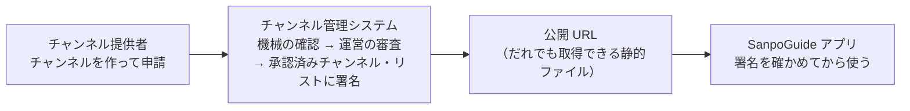

# チャンネル管理システム 利用ガイド

| 項目 | 内容 |
|---|---|
| 対象 | yorisoi-console（SanpoGuide の第三者のチャンネルを審査して公開するシステム） |
| 版 | 1.0 |
| 前提 | [DES-001](../design/DES-001-publisher.md)〜[DES-011](../design/DES-011-ecosystem.md)・[DES-013](../design/DES-013-studio.md)（スタジオ）の機能 |

## このシステムでできること

SanpoGuide のアプリは、語り手・話題・雰囲気をまとめて切り替える「チャンネル」を持っています。このシステムは、第三者（観光協会、店舗、愛好会など）が作ったチャンネルを**運営が審査し、合格したものだけを署名つきのリストにしてアプリに届ける**ためのものです。

アプリは、このシステムそのものではなく**署名**を信用します。システムが止まっても、アプリは最後に受け取ったリストで期限（最長 14 日）まで動きます。

もう 1 つ、**その場の素材**（区画ごとに運営から取る素材。今は **スタジオ**（素材提供者が出すお知らせ）と **一言**（アプリ利用者が置く投稿）の 2 種類で、種類どうしに関係はない）の管理もこのシステムで行います。運営がスタジオを出す素材提供者を承認し、承認された素材提供者は区画と期間を決めてお知らせを載せます。アプリは別のスタジオの API から、近くのスタジオと一言を取って読み上げます。運営は、通報されたスタジオ・一言に対応します。

## 読む人ごとの入口

| あなたは | 読むもの | 主にすること |
|---|---|---|
| **運営**（審査・公開の責任者） | [運営ガイド](operator.md) | ログイン、署名鍵と鍵セットの登録、公開の確認、チャンネル提供者の停止、チャンネルの取り下げ、操作の記録の確認、スタジオの承認と通報への対応 |
| **チャンネル提供者**（チャンネルを作る人） | [チャンネル提供者ガイド](publisher.md) | 登録、鍵の紐づけ、パッケージの作成と署名、申請、試用、更新 |
| **素材提供者**（素材を作る人） | [素材提供者ガイド](producer.md) | 素材集の作成と署名、申請、身元の確認、使っているチャンネル、毎日の確認 |
| **素材提供者**（スタジオを出す人） | [スタジオのガイド](studio.md) | スタジオを出す承認の申し込み、スタジオの作成（文・音声・区画・期間）、返されたときの申し出、聞いた数 |
| **開発・保守をする人** | [開発・保守ガイド](maintainer.md) | 手元での開発とテスト、配備、初期設定、運営の担当者の追加、費用と監視、障害の対応 |
| どの立場でも、まず | [仕組み](concepts.md) | 鍵と署名の関係、チャンネルが公開されるまでの流れ |
| 全体を図で見たい | [構成図](../architecture.md)（HTML 版 `docs/architecture.html` も） | 利用者と AWS の部品、リポジトリ、申請から公開まで、データの置き場所 |

## 使える機能

使えるのは、運営の画面（チャンネルと素材集の審査・鍵の移し替えを含む）、チャンネル提供者の画面（登録・鍵・鍵の移し替え・チャンネル・申請・機械の確認・試用チケット・審査の結果・取り消し・退会）、素材提供者の画面（素材集の登録・申請・身元の確認・使っているチャンネル・毎日の確認の結果）、スタジオの画面（提供者: 承認の申し込み・スタジオ・申し出・聞いた数、運営: 承認の審査・申し出・通報されたスタジオと一言・締め出し・置けない区画）、チャンネル提供者・素材提供者へのメール（開発用は記録だけ）、開発・保守の道具です。アプリでの試用チケットの読み込みも、SanpoGuide 側で実装済みです。

## 環境

| 環境 | 運営の画面 | 公開 URL（アプリが取得する） | 状態 |
|---|---|---|---|
| 開発用（dev） | https://d32w19p7au8cu2.cloudfront.net | https://d32t2reyxml47d.cloudfront.net | 稼働中。アプリには内蔵しない |
| 本番（prod） | — | — | まだない（本番用のアカウント、本番のルート鍵、独自ドメインがそろってから） |

## 用語集

| 用語 | 意味 |
|---|---|
| チャンネル | 語り手・話題・話す量・雰囲気をまとめた設定。アプリで切り替えて使う。ID は英小文字・数字・`-` の 3〜40 文字（例 `kamakura-history`） |
| パッケージ | 1 つのチャンネルの中身（`channel.json` とプロンプトの文章など）を ZIP にしたもの。形式は [platform API-CHANNEL-PACKAGE](https://github.com/duwenji/yorisoi-platform/blob/main/docs/contracts/API-CHANNEL-PACKAGE.md) |
| 版（version） | パッケージの版の番号。更新のたびに、最後に承認された版より大きくする |
| 申請 | パッケージを審査に出すこと。1 つのチャンネルに審査待ちの申請は 1 つまで |
| チャンネル提供者 | チャンネルを作って申請する人・団体。1 つのログインのアカウントが 1 つのチャンネル提供者 |
| 散策者 | SanpoGuide のアプリで散歩する人。チャンネルを選んで使う |
| 運営 | 審査・承認・取り下げ・鍵の管理をし、承認済みチャンネル・リストを出す主体。人を指すときは「運営の担当者」（管理者だけが作れる） |
| 提供者 | チャンネル提供者と素材提供者をまとめた呼び方。管理システムのアカウント（`publisher`）は両者で共通 |
| ルート鍵 | リストのいちばん大事な鍵。運営がネットワークにつながない端末に置き、鍵セットにだけ署名する。アプリはこの鍵の指紋（リストID）だけを信用する |
| 署名鍵 | AWS KMS の中にある鍵。リストに署名する。取り出せない。半年ごとに入れ替える |
| 鍵セット | どの署名鍵を使ってよいかの一覧。ルート鍵が署名する。署名鍵の追加・入れ替え・失効はこれで行う |
| 承認済みチャンネル・リスト | 承認されたチャンネルの一覧。署名鍵が署名し、公開 URL に置く。毎日作り直す |
| リスト・リストID | 承認済みチャンネル・リストを出す発行元のこと（platform API-CHANNEL-LIST の provider）。散策者は URL とリストID（`sc1…`、ルート鍵の指紋）で足す。ルート鍵を入れ替えると別のリストになる |
| `seq` | リスト・鍵セットの通し番号。公開のたびに増える。アプリは小さくなったリストを拒む |
| 取り下げ | 承認したチャンネルをリストから外すこと。アプリは理由とともに使用を止める |
| アカウントID | チャンネル提供者の公開鍵の指紋（`sg1…`）。チャンネル提供者はパッケージに対の秘密鍵で署名する |
| 素材集 | 素材提供者が作る、テキスト・画像・音声・映像の素材のまとまり。チャンネルとは別に審査・公開され、チャンネルが ID や基準で指して使う。形式は [platform API-MATERIALS](https://github.com/duwenji/yorisoi-platform/blob/main/docs/contracts/API-MATERIALS.md) |
| 素材提供者 | 素材集を作って申請する人・団体。アカウントはチャンネル提供者と共通で、「素材提供者として始める」で役割が加わる |
| 利用の記録 | どのチャンネルが、どの素材集のどの素材を使っているか。素材集の更新で使われている素材を消せないようにし、取り下げのときに知らせる先になる |
| 試用チケット | 審査前のチャンネルを、チャンネル提供者が自分の端末で試すための QR コード。7 日で切れる。アプリの開発者モードで読み込む |
| 準拠テスト | リストの公開 URL が platform API-CHANNEL-LIST の決まりを守っているかを外から確かめる道具 |
| 操作の記録 | 運営・チャンネル提供者の状態を変える操作を、だれが・いつ・何を・なぜしたか残したもの。消さない |
| 一言 | 散策者・走る人が、その場所に残す 60 文字までの文。アプリで声から文字にして置く。事前の審査はなく、自動の確認と通報で守る |
| スタジオ | 素材の種類の 1 つ。承認を受けた素材提供者が、区画と期間を決めて出すお知らせ（文と音声）。読み上げの前に出す名前を添える（platform REQ-STUDIO） |
| 一言 | 素材の種類の 1 つ。アプリ利用者がその場所に置く短い投稿。スタジオとは別のもの（platform REQ-NOTES） |
| 区画 | 位置の範囲を表す geohash。スタジオと取得は 6 文字（約 1.2 km × 0.6 km）、一言は 7 文字（約 150 m 四方） |
| 申し出 | 自動の確認で返されたスタジオについて、素材提供者が運営に確かめ直しを求めること |
| 締め出し | 消した一言を置いた端末が、一言を置けないようにすること（期間を決める） |
| 置けない区画 | 一言を置けず、スタジオも選べない区画。運営が決める |

## 関連する文書

| 文書 | 内容 |
|---|---|
| [platform 関係者と共通用語](https://github.com/duwenji/yorisoi-platform/blob/main/docs/overview/roles-and-vocabulary.md) | 散策者・チャンネル提供者・素材提供者・運営の役割と、関係者ごとの課題 |
| [構成図](../architecture.md) | システム全体を 8 枚の図で |
| [ADR-001](../adr/ADR-001-aws-architecture.md) | AWS の構成と、その理由 |
| [DM-001](../data-model.md) | データの持ち方と状態の移り方 |
| [API-001](../console-api.md)・[OpenAPI](../api/console.openapi.yaml) | 管理 API の契約 |
| [platform API-CHANNEL-LIST](https://github.com/duwenji/yorisoi-platform/blob/main/docs/contracts/API-CHANNEL-LIST.md) | 承認済みチャンネル・リストの形式（アプリとの約束） |
| [platform API-CHANNEL-PACKAGE](https://github.com/duwenji/yorisoi-platform/blob/main/docs/contracts/API-CHANNEL-PACKAGE.md) | パッケージの形式 |
| [platform チャンネル審査方針](https://github.com/duwenji/yorisoi-platform/blob/main/docs/policies/channel-review.md) | 何を確かめて承認・差し戻しにするか |
| [配備の手順](../operations/deploy.md)・[費用](../operations/cost.md) | 環境ごとの値と手順 |
| [鍵の手順書](../operations/keys.md) | ルート鍵の作成・保管、署名鍵の入れ替えの予定、失効、ルート鍵をなくしたとき |
| [platform 一言の利用規約](https://github.com/duwenji/yorisoi-platform/blob/main/docs/policies/notes-terms.md)・[platform スタジオの決まり](https://github.com/duwenji/yorisoi-platform/blob/main/docs/policies/studio-rules.md) | スタジオで、置いてはいけない一言・載せないスタジオと、運営の対応 |
| [スタジオの手順](../operations/studio.md) | スタジオの配備・利用規約の版・止め方・警報 |
