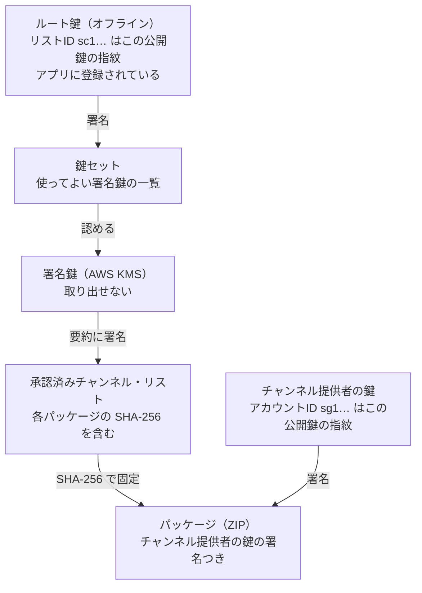
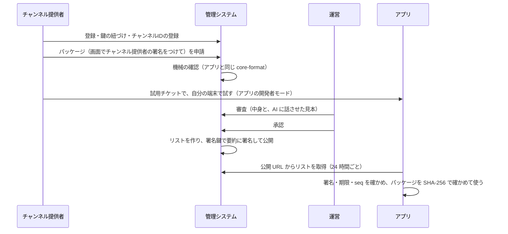
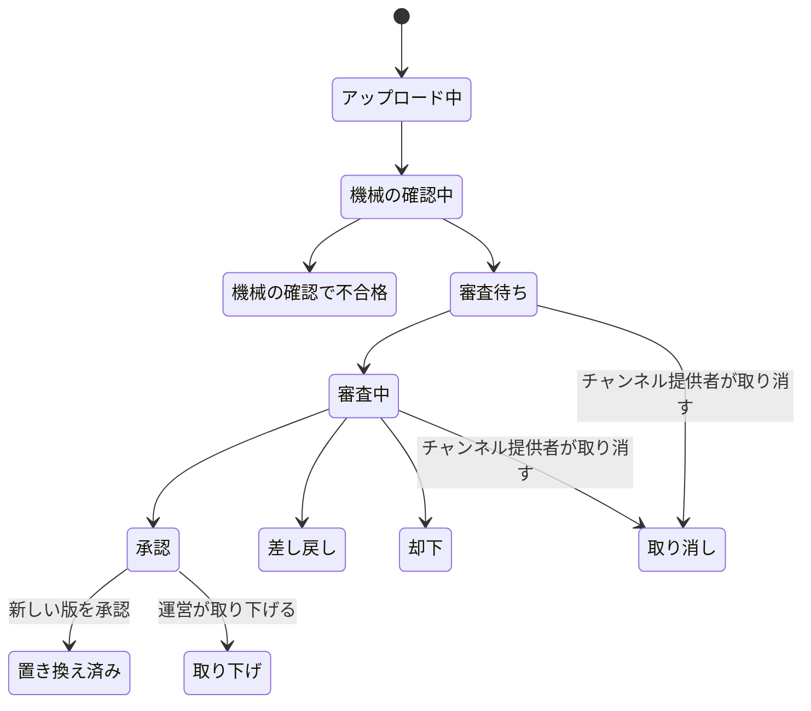
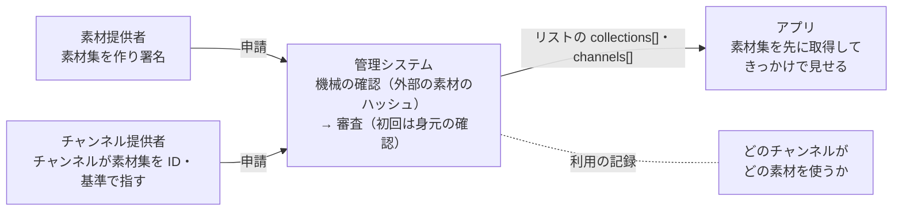
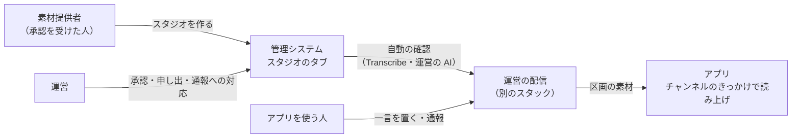

# 仕組み

[利用ガイド](README.md) ＞ 仕組み

このページは、どの立場の人にも共通の前提です。操作の手順は、立場ごとのガイドにあります。

## 1. 信頼のつながり

アプリは「だれが作ったか」「審査を通ったか」「途中で書き換えられていないか」を、すべて署名とハッシュで確かめます。置き場所（CloudFront）や通信経路は信用しません。

| 鍵 | だれが持つ | 何に署名する | 失ったとき・漏れたとき |
|---|---|---|---|
| ルート鍵 | 運営（オフラインの端末、複数の場所に写し） | 鍵セットだけ | 署名鍵を入れ替えられなくなる。新しいリストになり、アプリの更新が要る（開発用は作り直せばよい） |
| 署名鍵 | AWS KMS（だれも取り出せない） | リストの要約、試用チケット | 管理システムが乗っ取られたら、ルート鍵で新しい鍵セットを作って失効させる |
| チャンネル提供者の鍵 | チャンネル提供者（自分の端末だけ） | 自分のパッケージ | 運営の本人確認のうえで、新しい鍵に移し替える |

リストに直接ではなく「要約」に署名するのは、KMS が一度に署名できるのが 4,096 バイトまでだからです。要約はリスト本体の SHA-256 を含むので、本体を書き換えれば合わなくなります。

## 2. チャンネルが公開されるまで

承認のあとの「リストを作って署名して公開する」部分は、今動いています。運営の画面からの手動の公開、鍵セットの登録、取り下げ、毎日 03:00 の作り直しで、同じ処理が走ります。

## 3. チャンネルと申請の状態

**申請**（1 回のパッケージの提出）

- 1 つのチャンネルに、審査待ちの申請は 1 つだけです
- 差し戻されたら、直して新しい申請を出します（版の番号は同じでもよい）

**チャンネル**: `active`（有効）と `revoked`（取り下げ）の 2 つ。取り下げたチャンネルは、新しい版が承認されると `active` に戻ります。前に承認された版に自動では戻りません。

**チャンネル提供者**: `pending_key`（鍵の紐づけ待ち）→ `active`（有効）⇄ `suspended`（運営が停止）。退会すると `deleted`。

## 4. リストが届くまでの時間と、届かない場合

| できごと | アプリに届くまで |
|---|---|
| 承認・取り下げ・鍵セットの登録・手動の公開 | 公開は数秒。アプリは次の取得（起動時と散歩の開始時、前回から 24 時間以上たっていれば）で受け取る。公開 URL のキャッシュは 5 分 |
| 何もしない日 | 毎日 03:00（日本時間）に作り直し、期限（14 日）を延ばす |
| 管理システムが止まった | アプリは前回のリストで、その期限まで動く。期限が切れたリストのチャンネルは、次の散歩から使わない |
| 取り下げ | リストから消え、`revoked` に理由とともに 7 日載る。7 日より後に初めて取得した端末も、リストにないチャンネルは使わない（理由の表示とパッケージの削除だけがない） |

## 5. 決まりの一覧（上限）

| 決まり | 値 | 根拠 |
|---|---|---|
| 1 つのチャンネル提供者のチャンネル数 | 5（運営が変えられる。取り下げたものも数える） | DM-001 M-2 |
| 1 日の申請（アップロード） | 20（日本時間で数える） | DM-001 M-2 |
| 1 日の試用チケット | 10 | DM-001 M-2 |
| パッケージの大きさ | 2MB | platform API-CHANNEL-LIST |
| アイコン | PNG、256×256 以下、100KB 以下 | API-001 |
| リストの期限 | 発行から 14 日以内 | platform API-CHANNEL-LIST |
| 署名鍵の有効期間 | 鍵セットで 1 年以内（画面の既定は 180 日） | platform API-CHANNEL-LIST |
| 試用チケットの期限 | 7 日 | platform API-CHANNEL-LIST |
| 取り下げを `revoked` に載せる期間 | 7 日 | DM-001 M-9 |
| 承認されなかったパッケージの保存 | 90 日 | DM-001 M-4 |
| 操作の記録の保存 | 消さない | DM-001 M-3 |

## 6. 素材集と素材提供者

素材（テキスト・画像・音声・映像）は、チャンネルとは別に「素材集」として審査・公開されます（[platform ADR-MATERIALS](https://github.com/duwenji/yorisoi-platform/blob/main/docs/decisions/ADR-MATERIALS.md)）。素材集を作るのは素材提供者、それを使って散策者に見せるのはチャンネルです。

- 素材集の利用許諾（`grants`）で、使ってよいチャンネル提供者を決めます
- 管理システムは、どのチャンネルがどの素材を使っているか（利用の記録）を持ちます。使われている素材を消す更新は通らず、素材集の更新・取り下げはそのチャンネル提供者に知らせます
- 外部の素材は、申請のときにハッシュまで、公開中は毎日、取得できるかを確かめます
- 素材のあるチャンネル・素材集は、素材に対応したアプリの版が出るまで、アプリの一覧に出ません（必要なアプリの版が仮の大きな値になっています）

## 7. その場の素材（スタジオ・一言）

**その場の素材** は、運営が置き場を持ち、アプリが区画ごとに取る素材です。今は **スタジオ**（素材提供者が出す店や地域のお知らせ）と **一言**（散策者・走る人がその場所に置く投稿）の 2 種類があり、種類どうしに関係はありません。どちらも、近くを通る人のアプリで、チャンネルが決めたきっかけ（語りの合間など）に読み上げます（platform [ADR-MATERIALS](https://github.com/duwenji/yorisoi-platform/blob/main/docs/decisions/ADR-MATERIALS.md) D-44・[REQ-STUDIO](https://github.com/duwenji/yorisoi-platform/blob/main/docs/requirements/REQ-STUDIO.md)・[REQ-NOTES](https://github.com/duwenji/yorisoi-platform/blob/main/docs/requirements/REQ-NOTES.md)）。素材集とは、守り方が違います。

| | チャンネル・素材集 | スタジオ | 一言 |
|---|---|---|---|
| 出す人 | チャンネル提供者・素材提供者 | 運営がスタジオを出すことを承認した素材提供者 | アプリを使う人（利用規約に同意して） |
| 運営が確かめるもの | 中身を 1 つずつ審査する | **出す人** を承認のときに確かめる。中身はスタジオごとに審査しない | 事前には確かめない |
| 載せる前の自動の確認 | 機械の確認 | 文と音声の書き起こしを、運営の AI でスタジオの決まりに照らす | 連絡先の形と、運営の AI で利用規約に照らす |
| 届き方 | 署名したリスト（アプリが署名を確かめる） | 運営の配信（platform API-LOCAL-MATERIALS）から、区画（約 1.2 km × 0.6 km）ごとに | 同じ |
| 問題があったとき | 取り下げ | 通報で自動で止まり、運営が戻す・消す。承認を止める・取り消す | 通報で自動で隠れ、運営が戻す・消す。置いた端末を締め出す |
| 中身の責任 | 提供者 | 素材提供者 | 置いた人 |

- その場の素材の置き場と配信は管理システムとは別のスタックで動き、アプリは管理システムのリストではなく、運営の配信から取ります
- アプリで聞くのは、設定で「一言を聞く」「お知らせを聞く」をオンにした人だけです
- 決まりは platform の[一言の利用規約](https://github.com/duwenji/yorisoi-platform/blob/main/docs/policies/notes-terms.md)と[スタジオの決まり](https://github.com/duwenji/yorisoi-platform/blob/main/docs/policies/studio-rules.md)にあります。手順は[スタジオのガイド](studio.md)と[運営ガイド 13 章](operator.md#13-その場の素材スタジオ一言)です

