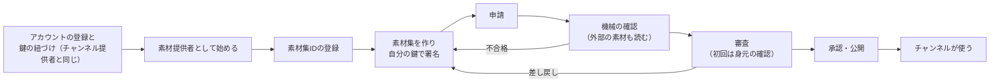

# 素材提供者ガイド

[利用ガイド](README.md) ＞ 素材提供者ガイド

テキスト・画像・音声・映像の素材を「素材集」にまとめて審査に出し、SanpoGuide のチャンネルから使ってもらうための手順です。観光協会の音声ガイド、写真家の写真集、語り手の朗読などを想定しています。チャンネルを作らなくても、素材だけを届けられます。

> チャンネルとは別に、スタジオに店や地域のお知らせ（掲載）を出すこともできます。同じアカウントで、運営に掲載を出す承認を申し込みます（[掲載者ガイド](studio.md)）。

> 素材提供者の画面: https://d32w19p7au8cu2.cloudfront.net（開発用）の「素材集」。アカウントはチャンネル提供者と共通で、鍵も同じものを使います。素材集の素材がアプリで出るのは、素材に対応したアプリの版が出てからです（それまで、素材集を使うチャンネルはアプリの一覧に出ません）。

## 目次

1. [全体の流れ](#1-全体の流れ)
2. [素材提供者として始める](#2-素材提供者として始める)
3. [素材集を作る](#3-素材集を作る)
4. [申請する](#4-申請する)
5. [審査と身元の確認](#5-審査と身元の確認)
6. [使っているチャンネルと更新](#6-使っているチャンネルと更新)
7. [毎日の確認](#7-毎日の確認)
8. [取り下げ・退会](#8-取り下げ退会)

## 1. 全体の流れ



素材集は、チャンネルとは別に審査・公開されます。チャンネルは、公開中の素材集を ID で指して使います。どのチャンネルが使うかは、利用許諾（`grants`）で決められます。

## 2. 素材提供者として始める

1. チャンネル提供者ガイドの「登録と鍵の紐づけ」のとおり、アカウントを作って鍵を紐づけます（チャンネルを作らない人も同じです）
2. 画面の「素材集」を開き、「素材提供者として始める」を押します

最初の素材集の審査で、運営が、名乗っている団体・個人であることと素材の権利を、登録した連絡先に確かめます。連絡先（設定）は、連絡のつくものにしておいてください。表示名を変えると、次の審査で確かめ直します。

## 3. 素材集を作る

形式は [platform API-MATERIAL-PRODUCER — 素材集の形式](https://github.com/duwenji/yorisoi-platform/blob/main/docs/contracts/API-MATERIAL-PRODUCER.md)が正本です。ここでは要点だけを書きます。

### 3.1 ファイルの構成

```
collection.json        設定（必須）
resources/
├── text/*.md          テキストの素材（Markdown の記法は使わない、2,000 字まで）
└── img/*.jpg・*.png・*.webp   小さな画像（300KB まで、長い辺 1,600px まで）
```

`signature.json` は画面が足すので、入れなくてかまいません。ZIP 全体は 2MB までです。大きな画像・音声・映像は、あなたの置き場所（HTTPS）に置き、`collection.json` に URL・SHA-256・大きさを書きます。

### 3.2 collection.json

```json
{
  "format": 1,
  "id": "kamakura-audio-guide",
  "version": 1,
  "producer": "sg1…（あなたのアカウントID）",
  "name": "鎌倉音声ガイド",
  "summary": "鎌倉市観光協会による寺社の音声ガイド",
  "lang": "ja",
  "grants": { "publishers": "*" },
  "resources": [
    { "id": "hachimangu-intro", "type": "text", "file": "resources/text/hachimangu.md", "tags": ["history", "faith"],
      "about": { "type": "spot", "osm": "way/123456", "name": "鶴岡八幡宮", "lat": 35.3260, "lon": 139.5565 } },
    { "id": "hachimangu-audio", "type": "audio",
      "url": "https://cdn.example.com/kamakura/hachimangu.ogg", "sha256": "…", "size": 2480000,
      "durationSec": 154, "mime": "audio/ogg", "transcript": "hachimangu-intro",
      "credit": { "author": "鎌倉市観光協会", "license": "permission" },
      "about": { "type": "spot", "osm": "way/123456", "name": "鶴岡八幡宮", "lat": 35.3260, "lon": 139.5565 } }
  ]
}
```

| 項目 | 書き方 |
|---|---|
| `id` | 登録した素材集 ID と同じ |
| `version` | 更新のたびに、最後に承認された版より大きくする |
| `producer` | 画面の「鍵」に出るあなたのアカウントID |
| `grants.publishers` | 使ってよいチャンネル提供者。`"*"`（誰でも）か、チャンネル提供者のアカウントIDの配列 |
| `grants.apps` | 使ってよいアプリ（任意）。アプリの ID（今は `sanpoguide`）を 1〜20 個。書かなければ、エコシステムのすべてのアプリで使えます（[platform API-MATERIAL-PRODUCER — 1.5](https://github.com/duwenji/yorisoi-platform/blob/main/docs/contracts/API-MATERIAL-PRODUCER.md)） |
| `grants.grounding` | AI の根拠に使ってよいか（任意。書かなければ使わない）。`true` にすると、アプリの AI が、題材の同じスポットを解説するときに、本文・代替テキスト・書き起こしを資料として読み、言い換えて話します。解説には「〇〇の資料をもとに作成」と出ます。資料は散策者が使う AI サービスに送られます。`true` のときは、本文・代替テキストに `{{` や URL を書けません（[platform API-MATERIAL-PRODUCER — AI の根拠](https://github.com/duwenji/yorisoi-platform/blob/main/docs/contracts/API-MATERIAL-PRODUCER.md)） |
| `resources[].tags` | 何の話かを表すタグ（`history`・`faith`・`architecture`・`nature`・`landscape`・`season`・`festival`・`food`・`craft`・`art`・`folklore`）。チャンネルが「歴史の音声があれば流す」のように基準で選ぶときに使う |
| `resources[].about` | 何についての素材か。スポット（OpenStreetMap の ID と名前）か地点（半径つき）。どちらも、おおよその緯度・経度を書く |
| `credit` | 画像・音声・映像では必須。作者とライセンス（SPDX の識別子、`PD`、`permission`） |
| `alt`・`transcript` | 画像は代替テキスト、音声・映像は書き起こし（テキストの素材の ID）が必須 |

外部の素材は、申請したあとで機械の確認が実際に読み、大きさと SHA-256 を確かめます。HTTPS で、リダイレクトしない URL に置いてください。社内のアドレスなど、インターネットから見えない場所は読みません。

## 4. 申請する

素材集の詳細の「新しい版を申請する」で、署名する前の ZIP・鍵のファイル・合言葉を選びます。画面が署名して送ります。秘密鍵はサーバーに送りません。

ZIP を選ぶと、申請の前に「AI の一次審査」を使えます。あなたの API キーで、ブラウザから直接 AI を呼び、審査基準に照らして気になる箇所を挙げます。キーは管理システムに送りません。運営の審査の代わりにはなりません。

機械の確認の結果は、申請の一覧に出ます。

| 出るもの | 意味 |
|---|---|
| エラー（`bad_resource` など） | 形式の誤り。直してもう一度申請する |
| 外部の素材 | 素材ごとに「大きさ・ハッシュが一致」か、取得できない理由 |
| 公開中のチャンネルが使っている素材 | 使われている素材を消した・種類を変えた。その版は通らない（チャンネルが壊れないように） |
| 注意（`grants_narrowed`） | 利用許諾を狭めて、使えなくなるチャンネルがある。通るが、そのチャンネル提供者に知らせが届く |

## 5. 審査と身元の確認

審査は無料です。機械の確認に合格してから 5 日以内に結果を出すのを目安にしています（運営の担当者が 1 人のため、目安です）。

運営は、素材の中身（出典・写っているもの・書き起こし・地点の安全）を確かめます。最初の素材集では、登録した連絡先で身元を確かめます。承認・差し戻し・却下はメールで知らせます（開発用では記録だけ）。

## 6. 使っているチャンネルと更新

素材集の詳細の「使っているチャンネル」に、公開中のチャンネルと、それが参照している素材が出ます。

- 新しい版を承認すると、使っているチャンネル提供者に知らせが届きます
- 使われている素材の ID を消したり、種類を変えたりした版は申請できません。消したいときは、そのチャンネル提供者に相談してください
- 公開中の版を止めたいときは、運営に取り下げを頼みます

## 7. 毎日の確認

毎日、公開中の素材集の外部の素材を、取得できて大きさが合っているか確かめます。取得できないものが見つかると、メールで知らせ、素材集の詳細の「毎日の確認」に出します。直るまで、その素材はアプリで出ず、チャンネルは次の候補（AI の解説など）に代わります。

## 8. 取り下げ・退会

- 運営が素材集を取り下げると、使っているチャンネルでその素材が出なくなり、それぞれのチャンネル提供者に知らせが届きます。新しい版の承認で公開に戻ります
- 退会すると、公開中の素材集もすべて取り下げられます（チャンネルと同じ）。素材集 ID は再利用できません
- 鍵をなくした・漏れたときは、チャンネル提供者ガイドの「鍵をなくした・漏れたとき」と同じ手順です。素材集も一緒に新しい鍵に移ります
