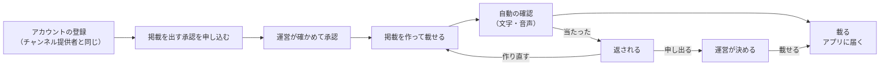

# 掲載者ガイド

[利用ガイド](README.md) ＞ 掲載者ガイド

スタジオに「掲載」（店や地域のお知らせ）を出すための手順です。掲載は、決めた区画を散策・走行している人のアプリで、語りの合間に読み上げられます。商店会の催し、観光協会の季節の案内、地域の行事のお知らせなどを想定しています。

> 画面: https://d32w19p7au8cu2.cloudfront.net（開発用）の「スタジオ」。アカウントはチャンネル提供者・素材提供者と共通です。チャンネルや素材集を出していなくても、掲載だけを出せます。

## 目次

1. [全体の流れ](#1-全体の流れ)
2. [掲載を出す承認を申し込む](#2-掲載を出す承認を申し込む)
3. [掲載を作る](#3-掲載を作る)
4. [確認と、返されたとき](#4-確認と返されたとき)
5. [載っている間](#5-載っている間)
6. [承認を止められたとき](#6-承認を止められたとき)

## 1. 全体の流れ

運営が確かめるのは、**掲載を出す人**（承認のとき）です。承認のあとは、掲載ごとの審査はありません。掲載の中身の責任は掲載者が持ちます（platform [掲載の決まり](https://github.com/duwenji/yorisoi-platform/blob/main/docs/policies/studio-placement.md)）。そのかわり、載せるたびに自動の確認があり、聞いた人は通報できます。

## 2. 掲載を出す承認を申し込む

1. [チャンネル提供者ガイド](publisher.md#2-登録と鍵の紐づけ)のとおり、アカウントを作ります
2. 画面の「スタジオ」を開き、「掲載を出す承認を申し込む」に次を入れます

| 項目 | 内容 |
|---|---|
| 出す名前 | 掲載に必ず添える名前（40 文字まで）。個人は、本名の代わりに屋号・活動名でかまいません |
| 団体・人 | どんな団体・人か、どこで活動しているか、本人確認の手がかり（1,000 文字まで） |
| 載せたいもの | どんなお知らせを、どの辺りで、どれくらいの頻度で（1,000 文字まで） |
| 掲載の決まりへの同意 | 掲載の決まりを読み、守ることと中身の責任を持つことに同意します |

3. 運営が、本人であること・出す名前が紛らわしくないこと・載せたいものが「載せない掲載」に当たらないこと・過去に承認を取り消されていないことを確かめます（目安 5 日、無料）。結果はメールで届きます
4. 見送られたときは、理由（掲載の決まりの項目番号）がメールで届きます。直せるものは、直して申し込み直せます

## 3. 掲載を作る

承認されると、「スタジオ」に掲載の一覧と「新しい掲載」が出ます。

| 項目 | 決まり |
|---|---|
| 文 | 200 文字まで。読み上げの前に「（出す名前）からのお知らせです」と添えます |
| 音声 | なくてもよい。M4A（AAC）、30 秒以内、512 KB 以内。文のあとに続けて流します |
| 届ける区画 | 地図で選ぶ（約 1.2 km × 0.6 km の区画、9 つまで）。「置けない区画」は選べません |
| 期間 | 今から 30 日以内に始まり、1〜30 日 |
| 読み上げる時間帯 | 決めると、毎日その時間帯だけ読み上げます（例 10:00〜18:00） |

「載せる」を押すと、音声を送ってから確認が始まります。中身を変えるときは、新しい掲載として作り直します（載っている掲載を書き換えることはできません）。

アプリで聞くのは、設定で「お知らせを聞く」をオンにした人だけです。1 人が聞くのは 1 時間に 2 件までで、同じ掲載は 1 日に 1 回です。

## 4. 確認と、返されたとき

確認は自動で、数秒〜1 分ほどで終わります（音声は文字に起こしてから確かめます）。

| 状態 | 意味 |
|---|---|
| 音声待ち | 音声がまだ届いていない。届かないときは作り直す |
| 確認中 | 確認をしている |
| 載っている | アプリに届いている（期間と時間帯の中だけ） |
| 返した | 確認で、掲載の決まり 2.2 のどれかに当たった。当たった項目と、音声の書き起こしが出る |
| 申し出中 | 運営が確かめている（7 日以内に返事） |
| 載せない | 運営が、申し出を受けて載せないと決めた |

返されたときは、直して新しい掲載として作り直すか、確認が誤っていると思えば「申し出る」で運営に説明します。運営は、AI の指摘だけで載せないと決めることはしません。

音声のエラー:

| 表示 | 対処 |
|---|---|
| 音声が M4A（AAC）でないか、512 KB を超えています | 形式と大きさを直して作り直す |
| 音声が 30 秒を超えています | 30 秒以内に縮める |
| 音声を文字に起こせませんでした | 雑音の少ない録音にして作り直す |
| 今は確認できませんでした | 少し待ってから作り直す |

## 5. 載っている間

- **止める**: 載っている掲載は、一覧の「止める」でいつでも止められます。止めた掲載は戻せません
- **聞いた数**: 「聞いた数を見る」で、日ごとの聞いた数・開いた数が出ます。3 人未満は出さず、3・10・30・100・300・1,000 の区切りで「○人以上」と出します（少ない数は、聞いた人の居場所の手がかりになるため）
- **通報**: 3 台以上から、または「安全を損なう」「権利の侵害」で通報されると、届けるのを止めて運営が確かめます。問題がなければ戻り、問題があれば消されて、理由がメールで届きます

## 6. 承認を止められたとき

掲載の決まりに反することを直さない・繰り返すと、運営は掲載を出す承認を期間を決めて止めます（載っている掲載も届かなくなります）。重い違反・なりすまし・権利の侵害を繰り返すと、承認を取り消します（載っている掲載は消え、申し込み直しは 1 年後からです）。どちらも、理由がメールで届きます。
