# 画面でチャンネルを作る

[利用ガイド](README.md) ＞ 画面でチャンネルを作る

チャンネル（`channel.json`・プロンプト・素材・きっかけ）と素材集を、ZIP を手で作らずに管理システムの画面で作る手順です。作りかけは下書きとして保存し、下書きのまま機械審査にかけ、そのまま署名して申請できます。決まりの詳細は [チャンネル提供者ガイド 3.5](publisher.md#35-画面で作る)・[素材提供者ガイド 3.3](producer.md#33-画面で作る)、設計は [DES-014](../design/DES-014-package-editor.md) にあります。

> 画面の画像は見本のデータで撮ったものです（鎌倉歴史散歩・鎌倉音声ガイドは例です）。画面: https://d32w19p7au8cu2.cloudfront.net（開発用）

用意するもの:

- 鍵を紐づけたアカウント
- 登録したチャンネル ID
- 鍵のファイルと合言葉（申請のときだけ）
- アイコンの PNG（申請のときだけ）

## 目次

1. [チャンネルを開く](#1-チャンネルを開く)
2. [始め方を選ぶ](#2-始め方を選ぶ)
3. [画面の上のバー](#3-画面の上のバー)
4. [基本](#4-基本)
5. [話し方](#5-話し方)
6. [プロンプト](#6-プロンプト)
7. [素材](#7-素材)
8. [きっかけ: スポット](#8-きっかけ-スポット)
9. [きっかけ: 地点を地図で選ぶ](#9-きっかけ-地点を地図で選ぶ)
10. [保存する](#10-保存する)
11. [機械審査にかける](#11-機械審査にかける)
12. [署名して申請する](#12-署名して申請する)
13. [申請の一覧で確かめる](#13-申請の一覧で確かめる)
14. [素材集の場合](#14-素材集の場合)
15. [そのほか](#15-そのほか)

## 1. チャンネルを開く

「チャンネル」で編集したいチャンネルを開くと、詳細に「画面で作る」の欄があります。

1. メニューの「チャンネル」を押し、チャンネル ID（例 `kamakura-history`）を押す
2. 「画面で作る」の「下書きを作る」を押す。下書きがあるときは「下書きを編集する（保存した日時）」になる

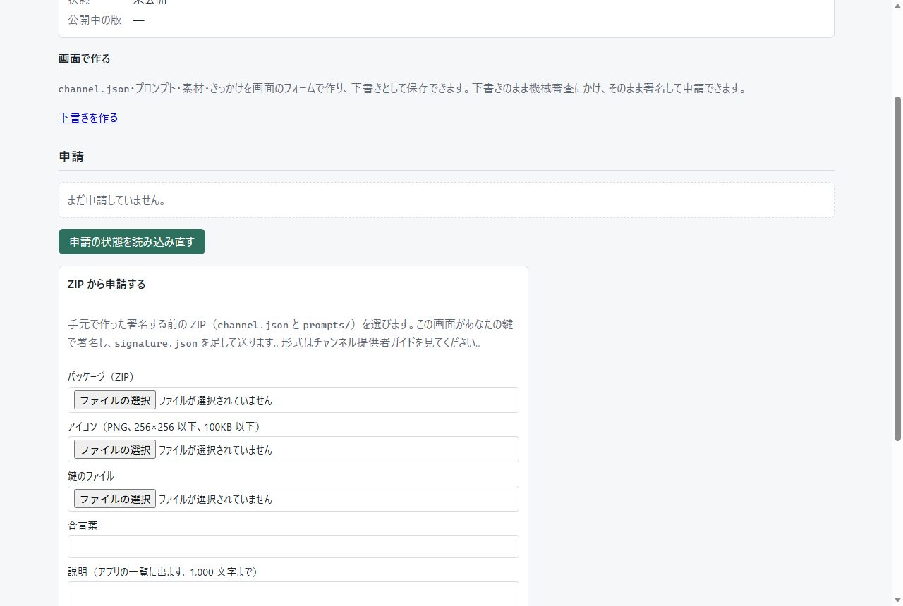

*チャンネルの詳細。状態・公開中の版の下に「画面で作る」の欄*

## 2. 始め方を選ぶ

下書きがまだないときは、何から始めるかを選びます。

1. **空から始める**: 必須の項目に既定の値を入れて始める。版は最後に承認された版 + 1
2. **自分の申請から**: 承認された版はいつでも、差し戻し・不合格などは結果から 90 日まで選べる。説明・タグ・アイコンも引き継ぐ
3. **手元の ZIP から**: 署名の前でも後でもよい（`signature.json` は捨てる）

どの始め方でも、パッケージのアカウントID は自分のものに直り、版は承認済みの版より大きくなります。

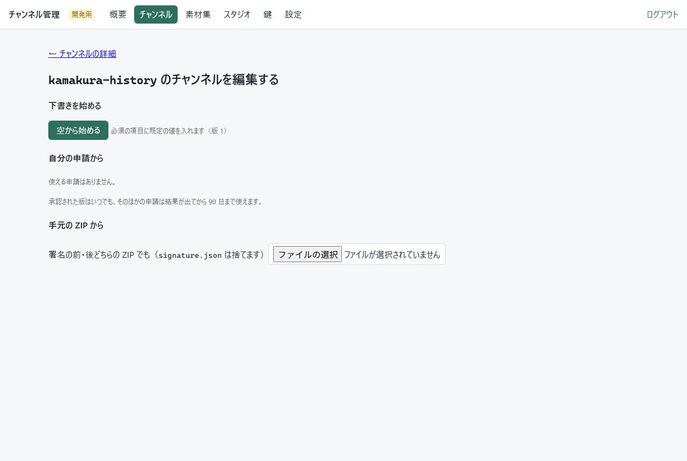

*下書きを始める欄。空から始める・自分の申請から・手元の ZIP から*

## 3. 画面の上のバー

編集の画面の上には、いつも保存のバーが出ています。下へ動かしても上に残ります。

1. 「保存していない変更があります」: まだ管理システムに残っていない
2. 「直すところ N 件」: 申請の前に直す項目の数。中身は下の「確かめる」に出る
3. 「ZIP を書き出す」: 署名する前のパッケージを手元に保存する
4. 「別のものから始め直す」: 始め方を選び直す（保存するまでは元の下書きが残る）

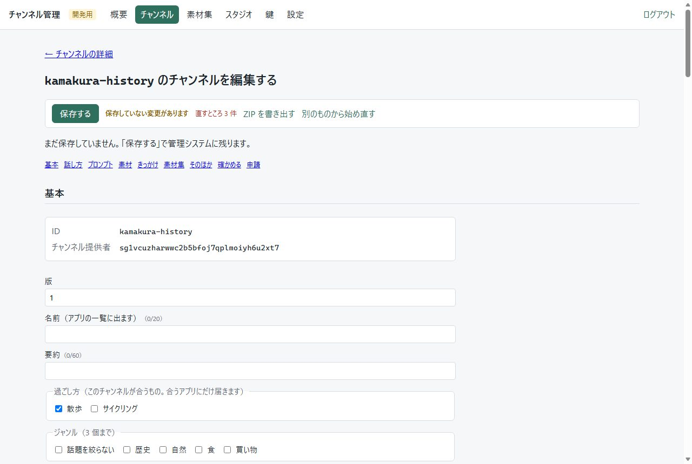

*空から始めた直後。保存のバーに「直すところ 3 件」*

## 4. 基本

名前・要約・過ごし方・ジャンル・必要な機能・あいさつを入れます。

1. 名前は 20 字、要約とあいさつは 60 字まで。欄の横に今の文字数が出る
2. 過ごし方に合うアプリにだけ届く。必要な機能を選ぶと、その機能のないアプリには届かない
3. あいさつは、切り替えたときにそのまま読み上げる（AI は使わない）

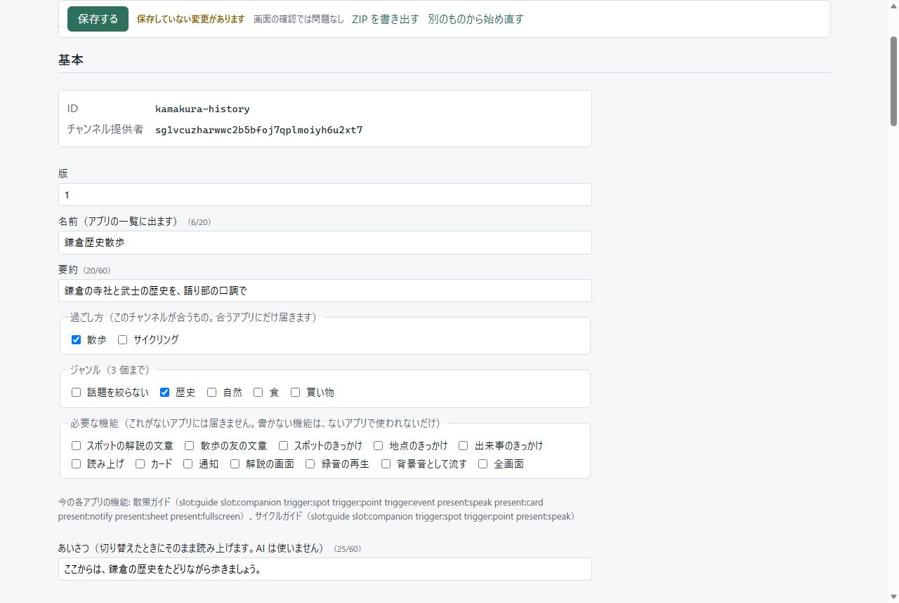

*基本の欄に名前・要約・ジャンル（歴史）・あいさつを入れたところ*

## 5. 話し方

話す頻度・話す出来事・スポットの好み・解説の長さ・背景音を選びます。

1. スポットの種類ごとに「ふつう・優先する・話題にしない」を選ぶ。優先は 8 個まで
2. 天気の急変・日の入り・施設の案内は、どのチャンネルでも話すので選ぶ欄はない

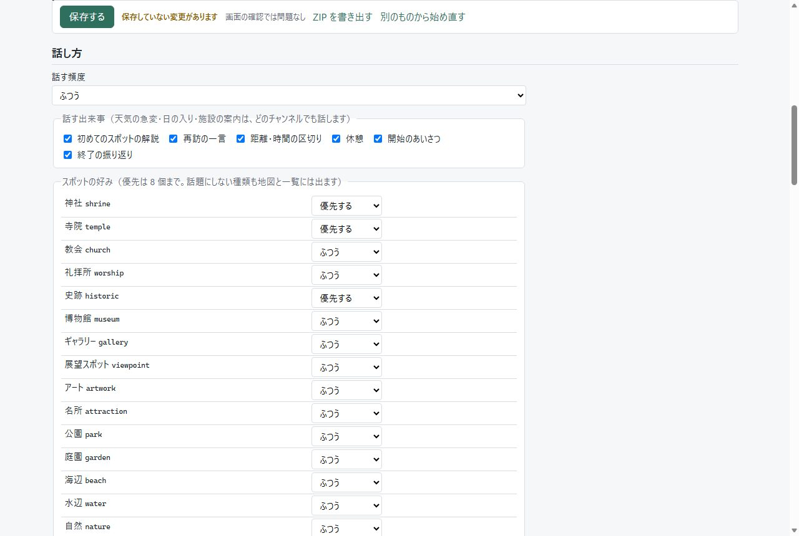

*話し方の欄。神社・寺院・史跡を「優先する」にしたところ*

## 6. プロンプト

AI の語り手と、重点を置くことを書きます。空の欄には標準の文章が入ります。

1. 欄ごとの上限（600 字・1,000 字・300 字）と合計 4,000 字
2. `{{`・URL・見出し（# で始まる行）は書けない。書くとその場で赤く出る

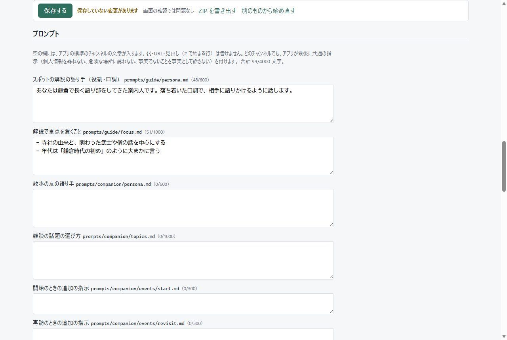

*プロンプトの欄に語り手と重点を書いたところ*

## 7. 素材

読み上げる文章や、カードに出す画像を足します。

1. 「テキストを足す」で本文を書く（2,000 字まで、URL は書けない）
2. 「画像を足す」でファイルを選ぶ（JPEG・PNG・WebP、300KB まで、長い辺 1,600px まで）。代替テキスト・作者・ライセンスは必須
3. 大きな画像・音声・映像は「外部の素材を足す」。URL を書き、手元のファイルを選ぶと大きさと SHA-256（音声・映像は長さも）をブラウザの中で計算する。ファイルは送らない
4. ID はきっかけから指す名前。変えるとファイルの名前も一緒に変わる

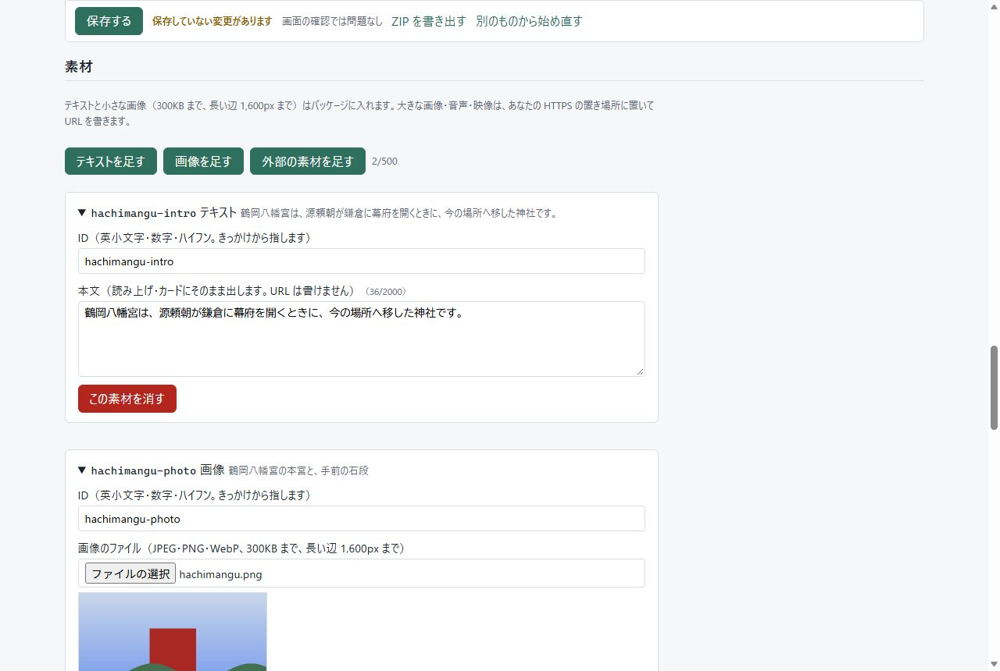

*素材の欄。テキスト hachimangu-intro と画像 hachimangu-photo*

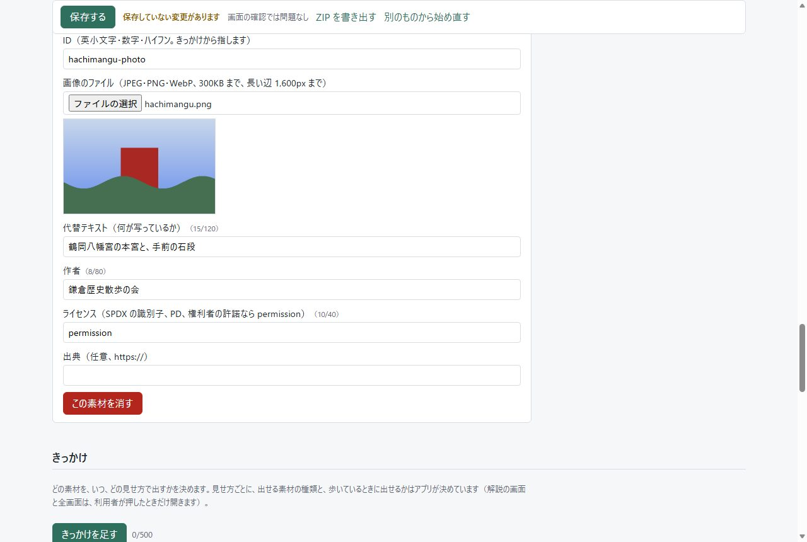

*画像の素材の欄。選んだ画像の見本と、代替テキスト・作者・ライセンス*

## 8. きっかけ: スポット

どの素材を、いつ、どの見せ方で出すかを決めます。

1. 「きっかけを足す」→ きっかけを「スポットに近づいた」にし、OSM の ID と名前を入れる
2. 「見せ方」を選び、出す素材を選ぶ。見せ方ごとに出せる素材の種類が決まっている（読み上げはテキストだけ、など）
3. 「見せ方を足す」で 4 個まで並べられる（上から順に出す）
4. 似たきっかけは「複製する」で作ると早い

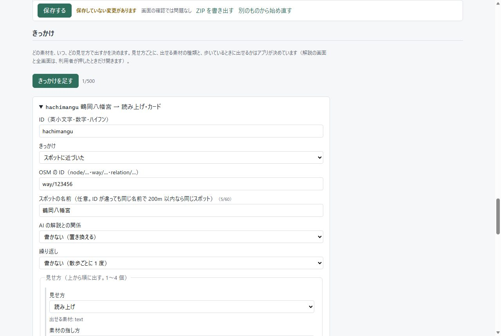

*鶴岡八幡宮のスポットのきっかけ。読み上げ・カードの 2 つの見せ方*

## 9. きっかけ: 地点を地図で選ぶ

地点のきっかけは、地図を押すか、緯度・経度を入れて位置を選びます。

1. きっかけを「地点の半径に入った」にし、半径（20〜300m）を入れる
2. 地図を押したところが位置になる。地図の上の欄に「緯度, 経度」（例 `35.3195, 139.5530`）を入れて「この位置にする」を押しても位置になる
3. 位置は地図の上の欄と「位置:」に出て、地図には赤い点と半径の円が出る。地図を押したときは縮尺も地図の位置も変わらない。欄に入れたときは、縮尺はそのままで、地図がそこへ動く
4. ドラッグで地図を動かし、＋・－で拡大・縮小。選び直すときは、もう一度押すか欄を書き直す
5. 車道・線路・私有地・立入禁止・危険な場所は避ける（審査で確かめる）

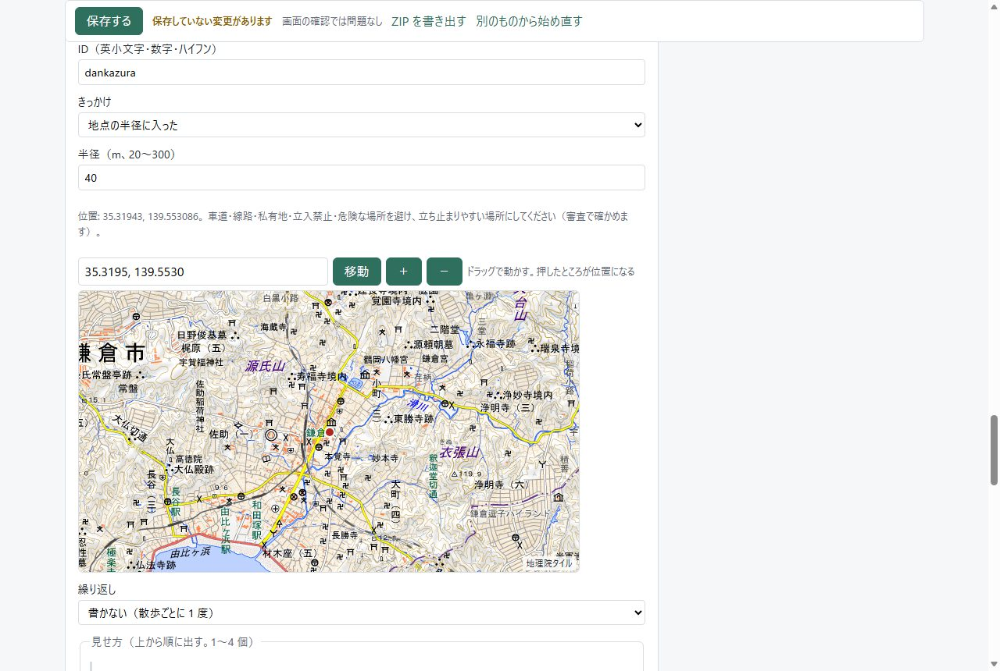

*地点のきっかけ。地理院タイルの地図に、選んだ位置と半径の円*

## 10. 保存する

「保存する」で、下書きを管理システムに残します。

1. どの端末からでも続きを編集できる。下書きはチャンネルごとに 1 つ
2. 最後の保存から 180 日で消える（バーに消える日が出る）。退会しても消える
3. 下書きはあなただけが見られる。運営も見ない。鍵のファイルと合言葉は下書きに入らない
4. 別のタブで先に保存されていたら、上書きせずに止まる。読み込み直してから続ける

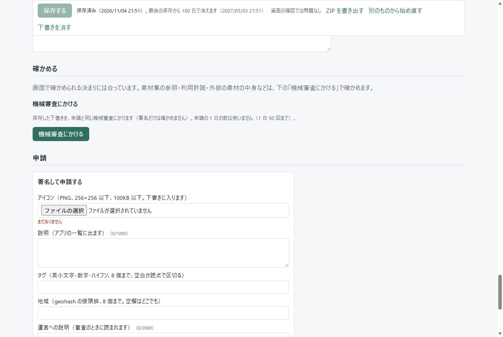

*保存したあと。バーに保存した日時と、消える日*

## 11. 機械審査にかける

保存した下書きを、申請と同じ機械審査にかけます。

1. 「確かめる」に直すところがなければ「画面で確かめられる決まりには合っています」と出る
2. 「機械審査にかける」を押すと、数秒〜数十秒で結果が出る。素材集の参照・利用許諾・外部の素材の中身など、画面では確かめられないところも確かめる
3. 申請の 1 日 20 回は使わない。下書きの機械審査は 1 日 50 回まで
4. 署名だけは確かめない。保存したあとに変えた分は「確かめていません」と出る

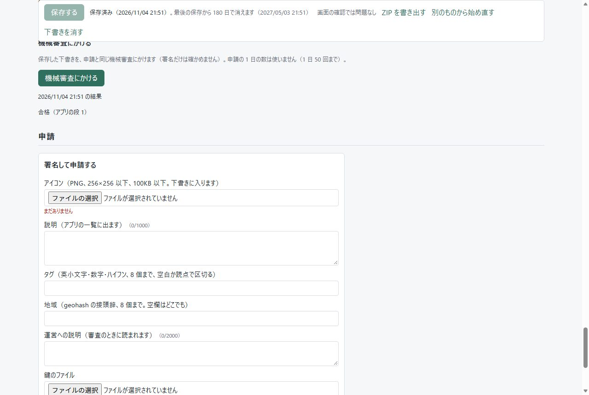

*機械審査の結果。合格（アプリの段 1）*

## 12. 署名して申請する

アイコンと申請の入力、鍵のファイルと合言葉を入れて申請します。

1. アイコン（PNG、256×256 以下、100KB 以下）・説明・タグ・地域・運営への説明は下書きに入る
2. 鍵のファイルを選び、合言葉を入れて「署名して申請する」。画面の中で署名して送る。秘密鍵はサーバーに送らない
3. 直すところが残っているか、アイコンがないと押せない
4. 下の「AI の一次審査」で、申請の前に AI に気になる箇所を挙げてもらえる（自分の API キーで）

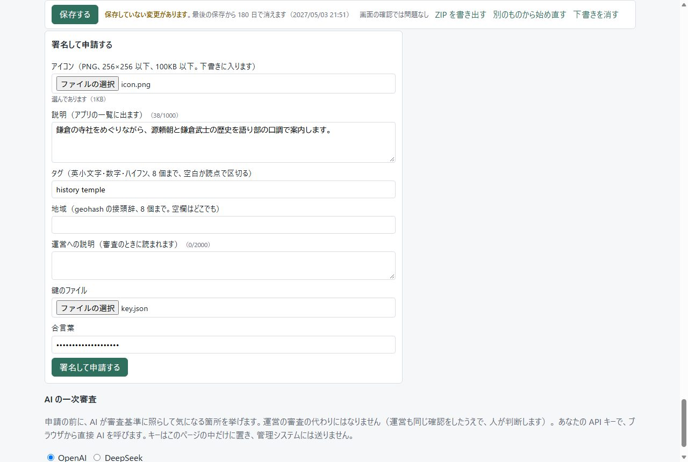

*申請の欄にアイコン・説明・タグ・鍵のファイル・合言葉を入れたところ*

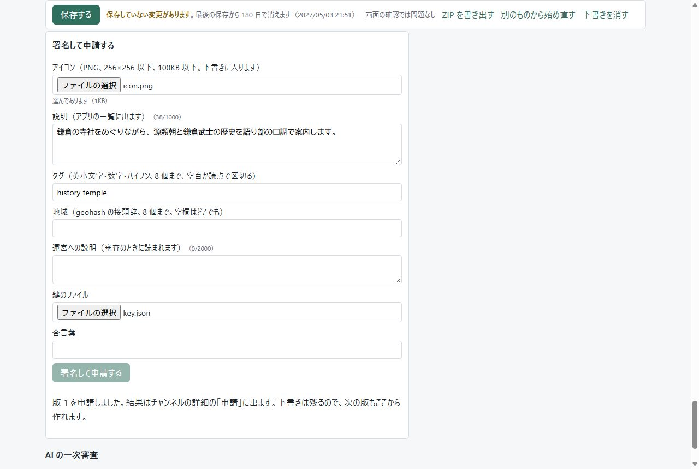

*申請したあと。「版 1 を申請しました」*

## 13. 申請の一覧で確かめる

チャンネルの詳細に戻ると、申請の一覧に出ています。

1. 機械の確認に合格すると「審査待ち」になり、試用チケットで自分の端末で試せる
2. 下書きは残るので、次の版も「下書きを編集する」から作れる

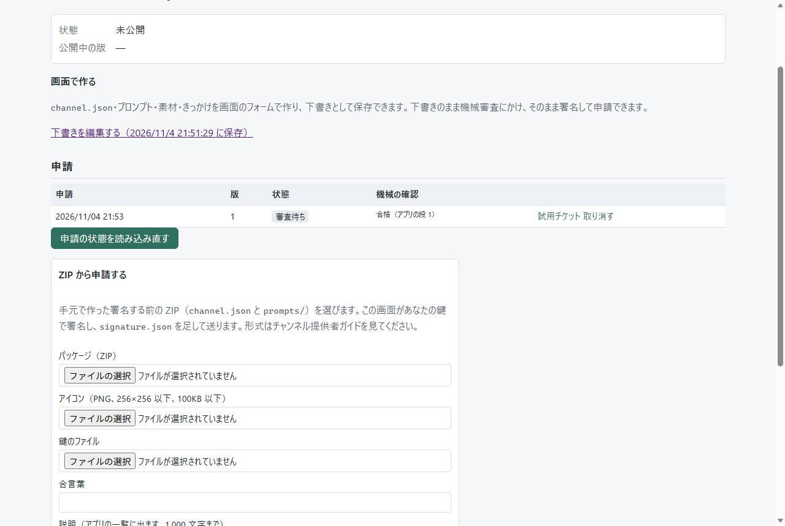

*チャンネルの詳細。版 1 が審査待ち、画面で作るの欄は「下書きを編集する」*

## 14. 素材集の場合

素材集も同じ流れです。「素材集」で素材集を開き、「画面で作る」から始めます。

1. 基本の欄に利用許諾（使ってよいチャンネル提供者・アプリ・AI の根拠）がある。きっかけ・プロンプトはない
2. 素材ごとにタグ（3 個まで）と題材（スポットか地点）を付ける。位置は地図を押すか、緯度・経度を入れて「この位置にする」で選ぶ
3. スポットの位置は、その中か境界から 100m 以内の点にする
4. 機械審査は外部の素材を実際に読むので、数十秒〜数分かかる

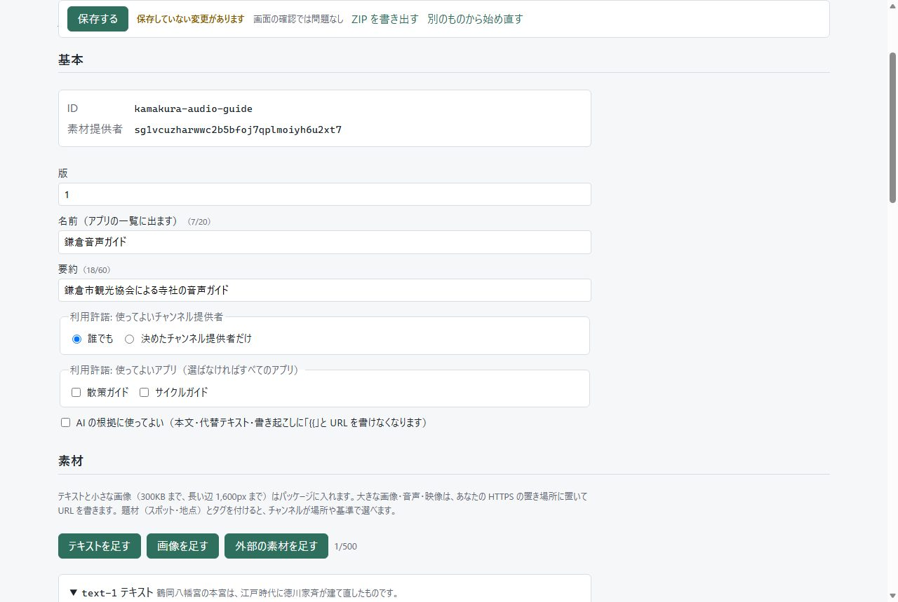

*素材集の基本の欄*

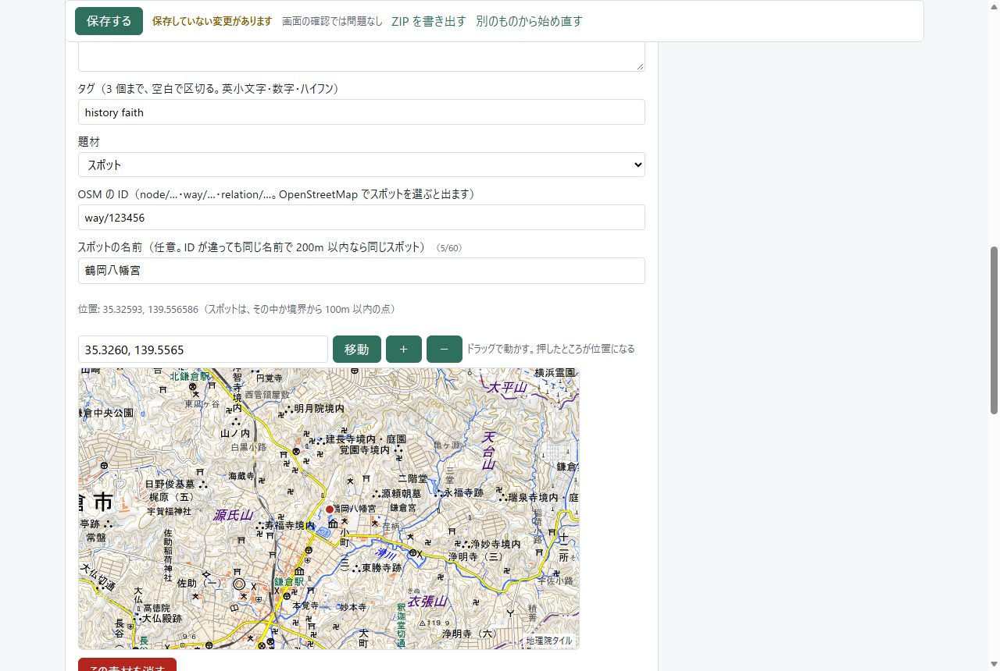

*素材の題材。鶴岡八幡宮の OSM の ID・名前と、地図で選んだ位置*

## 15. そのほか

- **ZIP から申請する**: 手元で作った ZIP を、チャンネルの詳細の「ZIP から申請する」で申請することもできます。
- **そのほかの項目**: フォームにない項目（`selectors`・`shorthands` など）は「そのほかの項目」に JSON で書きます。読み込んだ ZIP の項目は、フォームにないものも消えません。
- **下書きを消す**: 保存のバーの「下書きを消す」で消せます。元に戻せません。
- **取り下げ・停止**: 取り下げたチャンネルや、停止中のアカウントの下書きは、読み込み・書き出し・削除だけできます。
